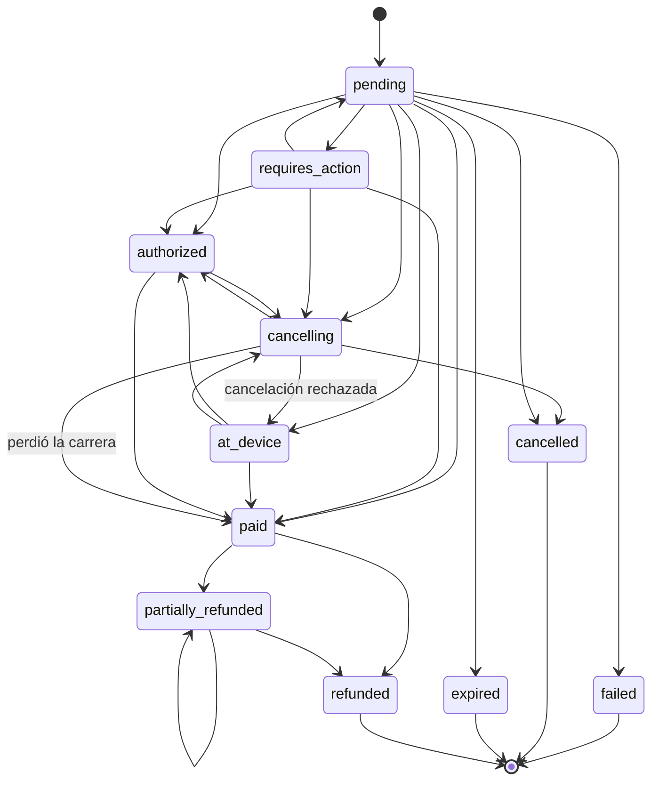

# RFC — Estándar de pagos de la plataforma (presencial y en línea)

**Fecha:** 2026-10-18 · **Estado:** propuesto; la fase K1 (contrato) se implementa en el PR que trae este documento · **Tarea:** 3.1 del plan de migración 7leguas → ops · **Código:** paquete `payments` y `capability/commerce.go` · **Referencia de campos:** [capabilities-commerce.md](capabilities-commerce.md)

Lo usan el POS, la caja, el kiosko, la pantalla de cliente, las tiendas (`storefront_cart`) y el marketplace (`local`). Mueve dinero real, así que cada regla de este documento tiene una prueba en el kernel o queda asignada a una tarea con su prueba.

## 0. Resumen de decisiones

| # | Decisión |
|---|---|
| D1 | Un solo registro canónico por cobro: `Payment`, con `Refund` como hijo y `PaymentEvent` para deduplicar. El kernel define la forma y las reglas (K1). El kernel también es el **único escritor** del ledger (K2): ni los proveedores ni los canales escriben `commerce_payments`. |
| D2 | El estado lo decide siempre el proveedor. Solo se aplica un estado **re-leído** con `commerce.payments.status`, nunca el cuerpo de un webhook. `payments.Observe` clasifica la lectura en aplicar, ignorar (duplicado o fuera de orden) o anomalía. |
| D3 | Once estados: los 9 de antes más `at_device` y `cancelling`. Se añadieron al final del enum para no romper a nadie. Un consumidor que no conoce un estado lo trata como no final. |
| D4 | Cinco canales: `terminal`, `online`, `qr`, `link`, `cash`. El reciclador de efectivo (CashDro) es canal `terminal` con método `cash`. `cash` es solo el cajón contado por el personal, con el proveedor interno `cash`. |
| D5 | La interfaz de proveedor son capacidades `commerce.payments.*`: `session`, `terminal.create`, `status`, `cancel`, `refund`, `confirm`, `capabilities`, `reconcile` y `terminal.devices`. El dinero va como cadena decimal y las credenciales son por organización (conectores). |
| D6 | Las terminales de tarjeta (MP Point, Clip) se manejan **en la nube**, con la API del proveedor desde su addon. El `ops-edge-agent` no lleva driver de tarjeta. Solo el CashDro, que vive en la LAN, va por el edge-agent. |
| D7 | Hay un solo evento neutral, `commerce.payments.confirmed`. Solo lo emite quien provee alguna capacidad `commerce.payments.*`, y el suscriptor exige `emitter == provider` y que el emisor sea proveedor de pagos en la org (`payments.DecodeConfirmed`), y que el evento sea del proveedor guardado en el pago (`Confirmed.ConfirmedFor`). Ningún canal escucha eventos con nombre de proveedor. |
| D8 | El hold de cobro es por documento, con TTL (300 s por omisión, acotado a [30 s, 1 h]) y token del dueño. Se toma **antes** del cobro físico. |
| D9 | El replay es idempotente por `idempotency_key`. Un cobro repetido nunca crea un segundo `Payment`: `payments.CheckReplay` responde `replay`, `already_paid`, `in_progress`, `retry_with_new_key` o `new`. |
| D10 | Marketplace v1: cobro por vendedor en la cuenta del vendedor (OAuth del proveedor por vendedor) con la comisión de la plataforma retenida en el mismo cobro (`seller.application_fee`). El cobro centralizado con liquidación a vendedores queda como decisión del dueño. |
| D11 | Devoluciones con un motor (addon `returns`) y dos puertas (en el POS y en un módulo aparte). El reembolso sale por este estándar: al método original, al monedero o en efectivo. Si la venta estaba facturada, la nota de crédito es **obligatoria**: el reembolso no está completo sin ella. |
| D12 | Stripe de la plataforma (hub, cobro a las organizaciones) no tiene relación con este estándar. El addon `stripe` de aceptación de pagos sí es un proveedor más. |

## 1. Capas y responsabilidades

```
canal (pos, caja, kiosk, customer_display, storefront_cart, local)
   │  hold · replay · suma de líneas · cambio/redondeo · UI · corte
   ▼
kernel (paquete payments + capability; ledger K2 en el host)
   │  forma canónica · transiciones · dedupe · evento neutral · conciliación
   ▼
proveedor (mercadopago, clip, stripe, conekta, cash_recycler, …)
      solo traduce a la API del proveedor; verifica firmas; re-lee el estado
```

- **Proveedor.** Traduce el contrato a la API del proveedor y nada más. No conoce documentos de OPS (solo `order_ref`), ni cajas, ni holds. Puede guardar una caché propia (`mp_payments`, `clip_checkouts`), pero esa tabla no es la verdad para nadie más.
- **Canal.** Orquesta el cobro: elige el proveedor y el dispositivo, toma el hold, aplica el replay, cuenta efectivo, calcula el cambio y lleva el corte. Nunca habla con la API de un proveedor ni lee tablas de proveedores.
- **Kernel.** Define los registros y las reglas (K1). Registra en el ledger cada resultado de una capacidad de pagos que pasa por el host (K2). Publica el evento neutral y corre la conciliación (K3).

Prueba de aceptación (principio 6): un restaurante, una farmacia o un consultorio usan todo esto sin tocar nada. Nada de lo anterior nombra una llantera ni un país. La tolerancia de redondeo, los métodos y los mínimos son datos de la organización o del proveedor.

## 2. Registros canónicos

### 2.1 `Payment` (un intento de cobrar un monto de un documento por un proveedor)

| Campo | Tipo | Regla |
|---|---|---|
| `id` | uuid | Lo asigna el ledger. |
| `document_type`, `document_id` | string | Requeridos. Es lo que se paga: `sales_order`, `checkout`, `invoice`, `layaway`… |
| `order_ref` | string | La referencia que se manda al proveedor (`external_reference`). |
| `channel` | `terminal\|online\|qr\|link\|cash` | Requerido. `cash` ⇔ `provider = "cash"`. |
| `provider` | string | Llave del addon. Queda fija para todo seguimiento (`PinRequired`). |
| `provider_ref` | string | Id del pago u orden de terminal en el proveedor. Obligatorio desde `authorized`. |
| `session_id`, `device_id` | string | Sesión o preferencia de origen; terminal o reciclador que cobró. |
| `idempotency_key` | string | Requerido. Es estable por intento de cobro y se reusa en cada reintento. |
| `status` | `Status` | Ver §3. |
| `amount`, `currency` | decimal, ISO 4217 | Positivo. Nunca flotante. |
| `amount_refunded` | decimal | ≤ `amount`. Debe cuadrar con el estado: `paid` ⇔ 0, `partially_refunded` ⇔ (0, amount), `refunded` ⇔ amount. |
| `fee`, `net` | decimal | `fee` ∈ [0, amount]. Si vienen los dos, `net = amount − fee`. |
| `method`, `installments` | string, int | Familia (`card`, `msi`, `oxxo`, `spei`, `wallet`, `cash`…) y número de MSI. |
| `card` | `{type, brand, last4, auth_code, entry_mode}` | `type` ∈ credit, debit, prepaid u other (de ahí sale la forma de pago fiscal). `last4` son 4 dígitos como texto. Nunca se guarda el PAN. |
| `cash` | `{tendered, change, operation_id, rounding}` | `operation_id` es la operación del CashDro, para conciliar. |
| `seller` | `{account_ref, seller_id, application_fee}` | Marketplace (§10). |
| `test_mode` | bool | Credenciales de sandbox. |
| `hold_token` | string | El hold bajo el que se cobró. |
| `anomaly` | string | Último `Observe` sin resolver (`late_capture`…). |
| `paid_at`, `created_at`, `updated_at` | tiempo | |

Un pago mixto (efectivo + tarjeta) son **varios** `Payment` del mismo documento. `NetCaptured()` es lo que aporta cada uno al total pagado (`paid` o `partially_refunded`, neto de reembolsos).

### 2.2 `Refund` (hijo de un `Payment`)

`id`, `payment_id`, `destination` (`original_method | wallet | cash`), `provider` y `provider_refund_id` (solo con `original_method`), `amount`, `currency`, `status` (`pending → succeeded | failed | manual_required`; `manual_required → succeeded | failed`), `reason`, `idempotency_key`, `source_type` y `source_id` (`sales_return`, cancelación, disputa), `credit_note_required`, `credit_note_id`, `cash_session_id`.

- `Refundable(p, refunds)` = capturado − max(`amount_refunded` que reporta el proveedor, Σ `succeeded`) − Σ (`pending`, `manual_required`). Es decir, el mínimo entre lo que queda según el ledger local y según el proveedor: un reembolso hecho en el panel del proveedor (sin fila `Refund`) no se puede volver a reembolsar. Un reembolso `failed` libera su monto. Uno pendiente lo reserva, para que dos devoluciones simultáneas no reembolsen de más.
- `CheckRefund` rechaza si el monto excede lo reembolsable, si la moneda difiere, si el pago no está capturado o si falta la llave. La misma `idempotency_key` con el mismo monto, moneda, destino y pago es un **replay** y devuelve el reembolso existente; con cualquier dato distinto es `ErrIdempotencyConflict`, nunca un replay de otro reembolso.
- `ApplySucceededRefunds` sube `amount_refunded` y el estado (`partially_refunded` o `refunded`) con los reembolsos que devolvieron dinero. Nunca lo **baja**: si las filas suman menos que lo que reportó el proveedor, el pago queda como está (la diferencia es un reembolso hecho fuera de OPS).
- `Complete()` es verdadero solo con `succeeded` y, si `credit_note_required`, con `credit_note_id`.

### 2.3 `PaymentEvent` (dedupe y auditoría)

Cada webhook, respuesta de sondeo y fila de conciliación que tocó un pago es un evento, se aplique o no: `provider`, `event_id`, `kind` (`payment | refund | dispute`), `source` (`webhook | poll | reconcile | staff`), `status` re-leído, `decision`, `reason` y `observed_at`.

- Índice único `(organization_id, provider, event_id)`, que es `PaymentEvent.DedupeKey()`. Un evento repetido no se aplica dos veces.
- Si el proveedor no numera la actualización (sondeo), se usa `DerivedEventID(kind, provider_ref, status, currency, amount, amount_refunded)`, con los montos normalizados (`"20.0"` = `"20.00"`). La misma lectura deriva siempre el mismo id, y un segundo reembolso parcial deriva uno distinto aunque el proveedor no mande `amount_refunded`: dos reembolsos de 30 y 20 son dos actualizaciones y el total queda en 50. Dos reembolsos del mismo monto sin `event_id` ni `amount_refunded` siguen siendo indistinguibles: el addon debe mandar uno de los dos.

### 2.4 Persistencia (K2)

Son tablas del kernel, con migración del kernel y prefijo `commerce_` para no chocar con `customers.payments`:

| Tabla | Clave / índices |
|---|---|
| `commerce_payments` | único `(org, provider, provider_ref)` cuando hay ref · único `(org, provider, idempotency_key)` · índice `(org, document_type, document_id)` · índice parcial de abiertos para la conciliación |
| `commerce_payment_events` | único `(org, provider, event_id)` |
| `commerce_refunds` | único `(org, payment_id, idempotency_key)` |
| `commerce_payment_holds` | único parcial `(org, document_type, document_id) WHERE status = 'active'` |

Relación con lo que ya existe (no se borra nada en K2):

- `customers.payments` sigue siendo el registro de **cobranza** (asignaciones a facturas, REP). Se alimenta del ledger 1:1 por `payment_id`.
- `pos_sale_payments` sigue siendo la línea de tender del POS. Gana `payment_id`, el id canónico.
- `customers.refund_tender_lines` es en la práctica el `Refund` canónico de una devolución. Gana `refund_id` y converge en K2.
- `mp_payments`, `clip_payments` y `clip_checkouts` quedan como caché del proveedor.

## 3. Estados y transiciones



(Además, `requires_action`, `at_device`, `authorized` y `cancelling` también pueden ir a `failed`, `cancelled` y `expired`. La tabla exacta está en `payments/status.go`.)

| Clase | Estados | Significado para el canal |
|---|---|---|
| **Abierto** (`Open`) | `pending`, `requires_action`, `at_device`, `authorized`, `cancelling` | Puede entrar dinero. **No** se cobra el documento otra vez ni se da por no pagado. |
| **Capturado** (`Captured`) | `paid`, `partially_refunded`, `refunded` | Hubo dinero. Solo `paid` y `partially_refunded` cuentan para el total pagado. |
| **Abandonado** | `failed`, `cancelled`, `expired` | No se movió dinero. Son finales. |

**`cancelling` no es `cancelled`.** Es el 202 de MP Point (cancelación encolada con la orden ya en la terminal). El comprador todavía puede pagar, así que el canal sigue sondeando hasta `cancelled`, `paid` o `at_device`.

**Comandos frente a observaciones:**

- Un **comando local** (el cajero pide cancelar, el personal registra efectivo) pasa por `payments.Command(canal, de, a)`: debe cumplir la tabla exacta (`Transition`) y, en todo canal con proveedor (terminal, online, qr, link), el único comando local es pedir `cancelling`. `cancelled`, `paid` o `failed` llegan solo por re-lectura. El efectivo de cajón (`cash`) lo cuenta el personal y admite cualquier movimiento de la tabla.
- Una **observación** (estado re-leído del proveedor) pasa por `payments.ObserveOutcome(pagoGuardado, resultado)` y nunca falla. Compara primero el dinero: otra moneda (`currency_mismatch`), otro `provider_ref` (`provider_ref_mismatch`), una autorización o captura por otro monto o un reembolsado fuera de `[0, monto]` o incoherente con el estado (`amount_mismatch`), y menos reembolsado que lo guardado (`refund_reversed`) son **anomalías**. Después clasifica el estado con `Observe(guardado, observado)`. La máquina es **monótona**: un estado abierto nunca reemplaza a uno posterior (`pending < requires_action, at_device < authorized`), y ningún camino pasa *a través* de `cancelling` (salvo que sea el estado guardado), así que un sondeo tardío de `at_device` no deshace un `authorized`. El pago guarda en `cancelled_from` el estado abierto desde el que se pidió la cancelación; si el proveedor la rechaza, la re-lectura puede volver a ese estado o a uno posterior, nunca a uno anterior (`authorized → cancelling → at_device` es `stale`). Una autorización o captura (`kind=payment`) sin `amount` es `invalid_outcome` y no se aplica:

| Caso | Decisión | Motivo |
|---|---|---|
| Mismo estado (salvo otro parcial) | Ignorar | `duplicate` |
| Alcanzable por movimientos válidos (aunque salte pasos: un `paid` perdido seguido de `refunded`) | Aplicar | |
| `authorized` o capturado después de `failed`, `cancelled` o `expired` | **Anomalía** | `late_capture`: dinero cobrado cuando ya se había dado por perdido. Es el `late_payment` de la tienda y el caso de la terminal que cobra después del timeout. |
| Estado abierto después de uno posterior (`authorized → at_device`, `requires_action → pending`) | Ignorar | `stale`: webhook o sondeo fuera de orden. |
| `failed`, `cancelled` o `expired` después de una captura | **Anomalía** | `capture_reversed` |
| Menos reembolsado de lo registrado (por estado o por monto) | **Anomalía** | `refund_reversed` |
| `partially_refunded` otra vez con el mismo total | Ignorar | `duplicate` |
| `failed` ↔ `cancelled` ↔ `expired` | Ignorar | `stale`: no hubo dinero en ninguno, se queda la primera palabra final. |

Una anomalía **no sobrescribe sola**. Se registra el evento, se marca `anomaly` en el pago, se avisa (métrica y notificación al rol de tesorería) y se vuelve a leer. Si la conciliación (§8) lee lo mismo otra vez, el ledger aplica el estado del proveedor como **corrección auditada**. El dinero lo decide el proveedor, pero nadie lo decide en silencio.

## 4. Canales

| Canal | Qué es | Cómo se crea | Proveedor |
|---|---|---|---|
| `terminal` | El comprador está frente a un dispositivo: terminal de tarjeta o reciclador de efectivo | `commerce.payments.terminal.create` (fijado al proveedor del dispositivo) | `mercadopago` (Point), `clip`, `cash_recycler` (CashDro) |
| `online` | Checkout alojado, widget embebido o voucher (OXXO, SPEI) | `commerce.payments.session` | `mercadopago`, `stripe`, `conekta`… |
| `qr` | El comprador escanea un QR en la pantalla de cliente, el kiosko o el ticket | `commerce.payments.session` con `channel: "qr"`; la salida trae `qr_data` o `qr_image_url` | El que lo soporte (`capabilities.channels`) |
| `link` | Liga de pago enviada al comprador (WhatsApp, correo) | `commerce.payments.session` con `channel: "link"` | `clip` (liga), `mercadopago`… |
| `cash` | Efectivo contado por el personal, sin dispositivo | Lo registra el canal; en K2, con el proveedor interno `cash` del host | `cash` (interno) |

El canal no decide qué proveedor soporta qué: lo pregunta con `commerce.payments.capabilities`. Ahí vienen los canales, el mínimo (`min_amount`), los reembolsos parciales, si la cancelación es asíncrona, la expiración de la orden de terminal, las MSI y el soporte de marketplace. El diálogo de cobro del POS y del kiosko se arma con esa respuesta, no con `if provider == "mercadopago"`.

## 5. Interfaz de proveedor

Un addon proveedor implementa las capacidades que le apliquen y declara cada una en `provides_capabilities[]`:

| Operación | Capacidad | Fija proveedor | Idempotente | Notas |
|---|---|---|---|---|
| create (en línea, QR, liga) | `commerce.payments.session` | no (selección por mercado) | sí | Sin cambios de forma; añade `channel`, `seller`, `qr_data` y `qr_image_url` opcionales. |
| create (presencial) | `commerce.payments.terminal.create` | **sí** (el dispositivo es de un proveedor) | sí | Responde `pending`, `at_device` o `failed`. Errores con código: `amount_below_minimum`, `device_not_found`, `device_offline`, `device_busy` e `invalid_input`. |
| status | `commerce.payments.status` | sí | — | La misma salida que `confirm`. Es la fuente de verdad. |
| cancel | `commerce.payments.cancel` | sí | sí | Responde `cancelled`, `cancelling` o `not_cancellable`. Siempre se re-lee el estado después. |
| refund | `commerce.payments.refund` | sí | sí | Añade `seller` y `refund_application_fee`; la salida, `provider_ref` y `provider_status`. |
| estado de reembolso | `commerce.payments.refund.status` | sí | — | Nuevo (K2). Lee un reembolso por su `refund_id` (GET, solo lectura); la salida es la de `refund`. Es la única re-consulta de un reembolso que el proveedor ya numeró. |
| confirm (webhook) | `commerce.payments.confirm` | sí | — | Verifica la firma y la ventana de repetición, y re-lee el pago. Nunca confía en el monto ni en el estado del cuerpo. |
| capabilities | `commerce.payments.capabilities` | sí | — | |
| conciliación | `commerce.payments.reconcile` | sí | — | Lista paginada (`from`, `to`, `cursor`) de salidas de `status`. |
| dispositivos | `commerce.payments.terminal.devices` | sí | — | Para ligar un registro de `payment_terminals` sin teclear ids. |

Campos nuevos (todos **opcionales**) en la salida de `confirm` y `status`: `channel`, `session_id`, `device_id`, `card{}`, `cash{}`, `seller{}`, `provider_status` y `status_detail`.

Reglas comunes:

1. **El estado siempre se re-lee del proveedor.** `status` consulta la API del proveedor; un webhook dispara una lectura, no una escritura.
2. **El dinero es cadena decimal** (`"1499.00"`) junto a una moneda ISO 4217. El paquete `payments` opera con `math/big`, nunca con `float64`. Si la API del proveedor usa centavos (`amount < 500` en MP Point significa menos de $5), la conversión vive dentro del addon.
3. **Las credenciales son por organización**, en el conector del addon (cifrado por el kernel). `test_mode` refleja credenciales de sandbox y viaja hasta el `Payment`.
4. **Idempotencia.** La `idempotency_key` del contrato es la llave de idempotencia del proveedor (`X-Idempotency-Key`). Si se vence el plazo, el resultado es **indeterminado**: no se reintenta con otra llave, se concilia o se reintenta con la misma.
5. **Retrocompatibilidad.** Las 4 capacidades originales conservan sus requeridos de entrada y de salida (`TestPaymentsStandardRetrocompatible`). Un proveedor viejo sigue siendo válido; solo no aporta los campos nuevos.

## 6. Capacidad `commerce.payments.terminal.*`

Flujo de cobro presencial (POS, caja, kiosko):

```
canal: CheckReplay → Acquire(hold) → terminal.create(device, monto, key)
   → muestra "en la terminal" → sondea commerce.payments.status (o espera el evento)
   → paid: registra el tender bajo el hold → Consume(hold)
   → cancelar: commerce.payments.cancel → cancelling → sigue sondeando hasta el final
```

- Las terminales de tarjeta se manejan **en la nube** (D6): MP Point Orders API, la API de Clip. El addon proveedor implementa `terminal.create` y `status`; el `ops-edge-agent` no participa. Esto cierra la parte de "driver de terminal" de la tarea 3.6: no hace falta driver local.
- El **CashDro** sí está en la LAN: el addon `cash_recycler` implementa `terminal.create`, `status` y `cancel`, y por dentro manda el comando `cashdro` al edge-agent de la estación. Sus credenciales se cifran como conector (tarea 3.5).
- Mientras el dispositivo tiene la orden, el canal **renueva el hold** (una orden de MP Point vive hasta 10 min y el TTL por omisión es de 5).

Reglas de MP Point heredadas de incidentes de 7leguas. Cada una se porta con su prueba en el addon (3.2):

| Regla | Dónde vive en el estándar |
|---|---|
| Mínimo de $5 | `capabilities.min_amount: "5.00"` y error `amount_below_minimum` (el canal lo valida antes y el proveedor lo repite) |
| La orden expira a los 10 min | `capabilities.terminal_expires_seconds: 600`; salida `expires_at`; la conciliación la pasa a `expired` |
| Cancelar con `x-allow-cancelable-status: at_terminal`; un 202 es cancelación encolada | El addon manda el header; un 202 responde `cancel.status = "cancelling"` y el pago queda en `cancelling` hasta re-leerlo |
| La cuenta rechaza MSI preestablecidas: reintentar sin cuotas | Dentro de `terminal.create`: la salida trae `installments` efectivas y `message`; el canal avisa al cajero |
| `resume` reanuda la orden viva en vez de recrearla | `CheckReplay` con la misma llave devuelve `in_progress` con el pago abierto: se sondea ese, no se crea otro |
| Sondeo de 2 s × 90, aviso a los 16 s si el aparato no descargó la orden | Regla del canal (UI). Si sigue en `pending` a los 16 s, se avisa "la terminal no recibió la orden" |
| Tipo, marca y últimos 4 para el CFDI | `card{type, brand, last4}` en la salida de `status`; `type` decide la forma de pago fiscal (crédito o débito) |

## 7. Evento neutral `commerce.payments.confirmed`

- **Payload:** `{provider, result}`, donde `result` es la salida de `confirm`/`status` (`kind`: `payment`, `refund` o `dispute`). Son opcionales `organization_id`, `occurred_at` (mercadopago 0.8.0 ya los mandaba y el esquema cerrado los rechazaba), `source`, `payment_id`, `document_type` y `document_id`.
- **Emisión:** el espacio `commerce.payments.*` está reservado. Solo lo publica un addon que provee alguna capacidad del dominio (`security.EmitPolicy`, regla `contract_namespace`). Las capacidades `terminal.*` están dentro del dominio, así que un proveedor solo de terminal (el CashDro) puede emitir. Un canal (POS, caja, kiosko) **no** puede, aunque lo declare (prueba en `security/emitpolicy_test.go`). El emisor lo estampa el host.
- **Emisión en modo `warn`:** los dominios de dinero (`EmitPolicy.EnforcedDomains`, por omisión `commerce.payments`) se aplican siempre como `enforce` mientras el grupo reservado no esté en `off`: ni durante el despliegue en `warn` un canal publica una confirmación de pago.
- **Flujo embebido:** `commerce.payments.submit` y `commerce.payments.client` (y `session.flow=embedded`) pertenecen al mismo dominio reservado, así que la regla de emisión no cambia. `source` gana `submit`, `hint` y `return` (al final de la lista). Regla del contrato: el monto de `submit` lo pone el host y el navegador solo aporta `provider_data`; una respuesta `pending`, `requires_action` o con ficha **no** es un cobro. Ver `docs/capabilities-commerce.md`, «Pago integrado».
- **Consumo:** `payments.DecodeConfirmed(raw, isProvider)` valida contra el contrato, exige `emitter` presente e igual a `provider`, y que `isProvider(emitter)` confirme que provee una capacidad `commerce.payments.*` en la org (obligatorio). Después el suscriptor deduplica por `emitter + EventID()`, busca el pago del documento y exige `ConfirmedFor(pago)` (mismo proveedor, `payment_id` y `provider_ref`), **re-lee** con `commerce.payments.status` fijado al proveedor **guardado en el pago**, nunca al `provider` del evento, y aplica la lectura con `ObserveOutcome`.
- **Qué se emite:** solo cambios que pueden mover un documento (no `pending` ni `requires_action`, como ya hace mercadopago). Los terminales emiten también `at_device` → `paid` y `cancelling` → `cancelled`.
- **K2:** el ledger del host, al aplicar una transición, publica el evento **con la llave del proveedor como emisor** y `payment_id` en el payload. Los suscriptores no cambian: el emisor sigue siendo el proveedor, y el `event_id` es el mismo que habría usado el addon, así que si los dos publican durante la transición el dedupe lo absorbe. Cuando K2 esté desplegado, los addons dejan de emitir el evento neutral por su cuenta (minor de cada addon).
- **Eventos propios de los proveedores** (`mercadopago.payment_confirmed`, `mercadopago.point_payment_approved`, `clip.*`): se siguen emitiendo por compatibilidad, pero **ningún canal se suscribe a ellos**. Hoy `caja` sí lo hace, y se migra en 3.4.

## 8. Job de conciliación (K3)

Corre en el host por organización y proveedor, con la cola de jobs del kernel ([background-jobs.md](background-jobs.md)):

1. **Abiertos** (cada minuto los presenciales y cada 5 min los en línea, con backoff): re-lee con `status` todo `Payment` abierto y lo aplica con `Observe`. Es el respaldo del sondeo de la UI. Si el cajero cierra la pantalla, el pago igual se resuelve.
2. **Expiración:** un pago abierto con `expires_at` vencido se re-lee. Si el proveedor no lo cerró, se cancela (`commerce.payments.cancel`) y se vuelve a leer. Nunca se marca `expired` sin preguntar.
3. **Ventana** (cada hora y al cierre del día): `commerce.payments.reconcile(from, to)` lista lo que el proveedor tiene. Lo que el ledger no conoce es un **huérfano** (pago sin documento, el "dinero tragado sin orden" del CashDro, una sesión indeterminada que sí cobró) y entra en la cola de anomalías con su `order_ref`.
4. **Anomalías:** una segunda lectura consistente aplica la corrección auditada. Una `late_capture` de un documento que ya se cobró por otro medio genera una **propuesta de reembolso** que aprueba un supervisor (primitivo de aprobaciones B4). Nunca se reembolsa sola.
5. **Indeterminados:** una llamada mutante que venció el plazo deja el `Payment` en `pending` con su llave. El paso 1 lo resuelve.
6. **Marketplace:** el paso 3 corre por vendedor (`reconcile.seller`) con las credenciales OAuth del vendedor, y cuadra `application_fee` contra lo que retuvo el proveedor.
7. **Métricas:** pagos abiertos por antigüedad, anomalías abiertas, huérfanos, diferencia entre ledger y proveedor por día, y latencia de confirmación (objetivo de tienda: p99 < 2 min, peor caso ≤ 5 min).

## 9. Hold de cobro (por documento, TTL y token)

Cierra la ventana entre que un punto de cobro **inicia** un cobro físico y el momento en que se registra (7leguas #604: la caja cobró un ticket mientras el CashDro seguía recibiendo billetes, y el dinero quedó dentro del aparato sin orden).

- `Acquire(current, {document, holder, token, ttl})`. El dueño que presenta su token **renueva**. Un hold vivo ajeno devuelve `*HeldError` (409 `in_payment`, con `holder` y `expires_at` para el mensaje "se está cobrando en Kiosko 1 hasta las 12:05"). Uno vencido o terminado se reemplaza.
- `CheckCharge(current, token)` corre antes de registrar cualquier cobro del documento, sea por el canal que sea.
- `Release(current, token, force)`: solo el dueño libera, salvo `force` cuando el documento ya quedó pagado. `Consume` lo marca usado al registrar el cobro; solo el dueño y solo con el hold activo y vigente (una copia vencida o liberada da `ErrHoldExpired`: detecta el traslape con quien tenga el documento ahora).
- El token es secreto (no se serializa: `json:"-"`) y se compara en tiempo constante. Por omisión lo genera `NewHoldToken` (`crypto/rand`, 256 bits); `Acquire` rechaza tokens de menos de 32 caracteres.
- TTL: 300 s por omisión, acotado a [30 s, 1 h] (`ClampHoldTTL`), configurable por organización (ajuste `payment_hold_ttl_seconds`, que hoy es del POS).
- **Atomicidad:** la da el almacén, con el índice único parcial de holds activos (§2.4) dentro de la misma transacción que evalúa `Acquire`; el almacén marca `expired` el hold vencido en esa misma transacción antes de insertar el nuevo (si no, el índice choca). K2 trae la prueba de concurrencia. El POS ya lo hace así con `pos_payment_holds` y las reglas `unique`/`sum_lte` del manifest. En K2 la tabla pasa al kernel para que el kiosko, la caja y la tienda compartan el mismo hold.

## 10. Replay idempotente y reglas del cobro

**Llave:** el canal la genera **una vez** por intento de cobro (`{document}:{uuid}`), la guarda en el estado de la UI y la reusa en cada reintento: timeout, recarga de la pantalla o reconexión de la terminal. Es la misma llave que se manda al proveedor.

`CheckReplay(pagosDelDocumento, reembolsosDelDocumento, llave, total)`. La llave es obligatoria (`ErrKeyRequired`) y lo pagado lo calcula `DocumentPaid` con los pagos y reembolsos que recibe, nunca un número del caller: cuenta lo capturado bruto menos solo los reembolsos que vinieron con una reducción del total (`Refund.adjusts_total`: devolución o nota de crédito). Un reembolso de cortesía o hecho en el panel no reabre la deuda. La llave debe ser **única por organización** en el ledger (K2), no solo dentro del documento.

| Veredicto | Cuándo | Respuesta al canal |
|---|---|---|
| `replay` | La llave ya tiene un pago capturado (un reintento tras timeout de un cobro que sí se registró: 7leguas 1eb71a72e) | Éxito con el pago original y `replay: true`. No se cobra. |
| `already_paid` | El documento ya está pagado por otros pagos | Éxito con forma de "ya estaba pagada" (`replay: true`, sin pago nuevo). **No se cobra**, y con efectivo no se devuelve dinero por esto. |
| `in_progress` | Hay un pago abierto del documento (de esta llave o de otra) | Reanudar o sondear ese pago. Nunca crear otro. |
| `retry_with_new_key` | La llave es de un intento `failed`, `cancelled` o `expired` | El canal genera una llave nueva (el proveedor contestaría el resultado viejo). |
| `new` | Nada de lo anterior | Cobrar. |

Reglas del cobro, en orden:

1. **El total sale del documento guardado**, nunca del cliente. `CheckLinesTotal(total, líneas…)` exige que el total sea la suma de las líneas guardadas (7leguas orden 71621).
2. `CheckTenders(declarado, tenders…)`: los tenders suman **exactamente** lo declarado y ninguno es cero o negativo. Una fila con importe sin método se rechaza (7leguas 649f6197f).
3. `Settle(Collection{currency, total, already_paid, non_cash, cash, cash_tolerance})`. La parte no efectivo nunca excede lo debido (`ErrExceedsTotal`: una tarjeta cobrada de más jamás se devuelve en efectivo). Solo el efectivo da cambio, y el cambio nunca excede el efectivo entregado. Un faltante del efectivo ≤ tolerancia se absorbe como `rounding` (el reciclador no da monedas menores a la mínima: 7leguas a8f3e6df6); la tarjeta nunca redondea. Montos negativos son `ErrNegativeAmount` y todo monto se cuantiza a la moneda (`ErrNotQuantized`). La **tolerancia es un ajuste de la organización** (hoy `cash_rounding_tolerance_cents` del POS, $0.50 por omisión) dentro de un tope del kernel: `MaxCashTolerance` = una unidad de la moneda menos su unidad mínima (0.99 MXN, 0.999 KWD, 0 JPY). `CheckCashTolerance` valida el ajuste al guardarlo y `Settle` rechaza uno fuera de rango (`ErrInvalidTolerance`): una configuración mala no perdona deudas. Además del tope absoluto hay uno relativo: el redondeo no puede pasar de la constante `MaxRoundingPercent` (10 %) de lo que el efectivo debía cubrir, así que 0.01 en efectivo no salda un adeudo de 0.50. Un faltante mayor deja `Remaining`, y el canal decide si el documento admite pago parcial (apartados).
4. El cobro y el estado del documento se escriben **en una sola transacción**, bajo el hold.

**Reglas por método que se portan con prueba (3.4, 3.5):**

- **Monedero:** al cancelar se revierte el **neto** aplicado (no el bruto) y sin doble resta. Es un `Refund` con `destination: wallet` por pago de monedero, con su `idempotency_key`.
- **Crédito:** se emite como PPD y el REP se timbra **después** del commit del pago. El ledger publica y la facturación (Fase 4) escucha.
- **Cancelación granular por pago:** cada `Payment` se cancela o reembolsa por separado, con reverso de caja (movimiento de salida en la sesión) y de monedero, sin doble resta.

## 11. Marketplace (`local`)

**v1: cobro por vendedor** (recomendado):

- Cada vendedor liga **su** cuenta del proveedor por OAuth (MP: Marketplace/OAuth; Stripe: Connect). El token se guarda como credencial de conector **del vendedor**, cifrada y con rotación del refresh. El vendedor puede desligarla; sin cuenta ligada no puede vender con ese proveedor.
- El carrito se agrupa por vendedor. Cada sub-pedido es un documento y su cobro es un `Payment` con `seller{account_ref, seller_id, application_fee}`. El proveedor cobra en la cuenta del vendedor y retiene la comisión de la plataforma en el mismo cobro (MP `marketplace_fee`; Stripe `application_fee_amount`).
- **Comisión:** la calcula la plataforma (configuración por vendedor o categoría del addon de marketplace, nunca el kernel) y queda guardada en el `Payment`. **Regla normativa:** `seller` y `refund_application_fee` se derivan en el servidor. El host (K2) los estampa desde la configuración del marketplace e ignora lo que mande el canal, y el proveedor cobra con los del `Payment` guardado. La validación del manifest rechaza mapearlos desde `payload.*`, y `ValidateSeller` acota la comisión a `[0, monto]`. El ledger reporta el ingreso de la plataforma por `application_fee`. No tiene relación con el Stripe del hub (D12).
- **Varios vendedores en un carrito:** si el proveedor soporta dividir un solo cargo (`capabilities.marketplace_split`), es un cobro por vendedor dentro de una sola experiencia de pago. Si no, el checkout cobra los sub-pedidos en secuencia, o la tienda limita el carrito a un vendedor. Lo decide la configuración de la tienda con lo que diga `capabilities`.
- **Reembolsos:** van por el `Payment` del vendedor. `refund_application_fee` decide si la plataforma también devuelve su comisión (política de la plataforma; por omisión, proporcional en devoluciones y completa en cancelaciones previas al envío).
- **Conciliación por vendedor:** §8, paso 6.
- **Contratos que faltan (fase M1, no registrados en K1):** `commerce.payments.accounts.link` (inicia el OAuth y devuelve `authorize_url`), `commerce.payments.accounts.status` (cuenta ligada, capacidades, si puede cobrar) y `commerce.payments.accounts.unlink`. Se registran cuando `local` empiece la integración, con su prueba de sandbox.

**v2 (❓ dueño): cobro centralizado** (la plataforma cobra todo y liquida a los vendedores). La experiencia es mejor, pero la plataforma recibe el dinero de terceros, con implicaciones fiscales y regulatorias por país (en MX, el régimen de plataformas tecnológicas y sus retenciones). Necesitaría contratos `payouts.*`. No entra en v1.

## 12. Devoluciones: un motor y dos puertas

```
puerta POS (desde la venta o el ticket, sin salir)   puerta módulo (cualquier documento)
                         \                              /
                          ▼                            ▼
                  addon returns: SalesReturn (líneas ≤ vendido − ya devuelto,
                  reingreso a inventario, motivo, aprobación si aplica)
                          │ plan de reembolso
                          ▼
     por cada Payment original (del más reciente al más antiguo, hasta lo reembolsable):
       original_method → commerce.payments.refund (fijado al proveedor, misma key en reintentos)
       wallet          → crédito al monedero (WalletTransaction, idempotente)
       cash            → salida de la sesión de caja abierta (RefundClaim)
                          │
                          ▼
     ¿documento facturado? → nota de crédito OBLIGATORIA (Refund.credit_note_required)
```

- **Un solo motor:** el addon `returns` es el dueño de la lógica (cantidades devolvibles, inventario, aprobaciones). El POS no reimplementa nada: abre el mismo flujo como acción embebida.
- **Destino del reembolso:** por omisión, el método original. El cajero puede elegir monedero o efectivo. Si el reembolso al método original no está disponible (fuera de `refund_window_days`, proveedor sin reembolso, terminal sin reembolso), el sistema propone efectivo o monedero, y elegir efectivo **contra un pago con tarjeta** pide aprobación de supervisor (B4).
- `manual_required` (el proveedor no puede devolver: BNPL, efectivo del proveedor) queda pendiente hasta que el personal confirma. Mientras tanto reserva el monto.
- **Nota de crédito:** si la venta estaba facturada, **siempre** se genera, sea cual sea el destino del reembolso. `Refund.Complete()` es falso sin `credit_note_id`, y la devolución no se cierra. El contrato fiscal de la nota de crédito es de la Fase 4 (hoy solo existen `fiscal.invoice.create` y `fiscal.invoice.cancel`). Es una **dependencia** de 3.7.
- **Impuestos:** si hubo `commerce.tax.commit`, se llama `commerce.tax.reverse` con la misma llave de la devolución.

## 13. Plan de migración

**Kernel (cadena):**

| Fase | Qué | Repo | Bloquea |
|---|---|---|---|
| **K1** (este PR) | Contrato: estados, canales, capacidades nuevas, campos opcionales, paquete `payments` (tipos, transiciones, `Observe`, holds, replay, `Settle`, reembolsos, `DecodeConfirmed`), política de emisión probada | kernel | 3.2, 3.3, 3.5 (los proveedores ya pueden implementar) |
| K2 | Ledger: tablas `commerce_*`, servicio de registro con transiciones y dedupe, registrador en la frontera de capacidades del host, proveedor interno `cash`, holds compartidos, publicación del evento neutral por el ledger | kernel + ops | 3.4, 3.7, 3.8 (canales sobre el ledger) |
| K3 | Job de conciliación, cola de anomalías, métricas | kernel + ops | operación segura en producción |
| M1 | `commerce.payments.accounts.*` (OAuth por vendedor) | kernel | marketplace en `local` |

Cadena de versiones: tag del kernel (minor) → **ops** sube el pin (requerido: el `Engine` de ops responde `ErrNotQuery` a una capacidad que no está registrada) → addons. El manifest no cambia de esquema (las llaves de capacidad son datos y una llave desconocida ya es válida), así que el hub no es obligatorio. Aun así se sube `addons/tools/manifestcheck` para que valide los mapeos `payload.*` contra los campos nuevos.

**Addons (en orden):**

| Addon | Tarea | Cambios |
|---|---|---|
| `mercadopago` | 3.2 | `confirm`/`status` llenan `channel`, `card`, `device_id`, `session_id` y `provider_status`. Implementa `cancel`, `capabilities`, `reconcile` (`/v1/payments/search` por ventana), `terminal.create` y `terminal.devices` sobre la Orders API con las reglas de §6. Emite el neutral también para terminal (hoy solo `point_payment_approved`). |
| `clip` | 3.3 | Lo mismo que mercadopago. Driver de terminal en la nube (API de Clip) o se retira el `edge_device` `clip_terminal` hasta que exista. La liga sin sandbox: `capabilities.test_mode = false` y prueba con simulador. |
| `cash-recycler` | 3.5 | Provee `terminal.create`, `status` y `cancel` (canal `terminal`, método `cash`) sobre el comando `cashdro` del edge-agent. Guarda `operation_id`. Las credenciales salen de `cash_recyclers.password` y pasan a un conector cifrado. Caso "dinero tragado sin orden": la operación se registra **antes** de abrir el aparato y el huérfano lo detecta la conciliación. |
| `payment-terminals` | 3.3/3.5 | El registro de dispositivo guarda `provider` + `provider_device_id`. El canal fija `terminal.create` con ese proveedor. Usa `terminal.devices` para ligar. |
| `pos` | 3.4 | Diálogo de cobro genérico por `capabilities`. `CheckReplay` + hold antes de `terminal.create`. Escucha solo `commerce.payments.confirmed`. `pos_sale_payments.payment_id` apunta al id canónico. `pos_payment_holds` pasa a los holds del kernel en K2, conservando los códigos estables (`in_payment`, `already_paid`, `amount_mismatch`…). |
| `caja` | 3.4 | Deja de suscribirse a `mercadopago.payment_confirmed` y `mercadopago.point_payment_approved`. Se suscribe a `commerce.payments.confirmed` con `DecodeConfirmed` (o su réplica en el guest), dedupe y re-lectura. |
| `kiosk` | 2.4 | Bloque `payment` sobre lo mismo que el POS: hold, `in_progress` = reanudar, cancelar = `cancel` + seguir hasta el final. |
| `storefront_cart` | 3.8 | Retira la integración directa de MP (I-H14), manda `channel` y lee el ledger en K2. `late_payment` = anomalía `late_capture`. `payment_status` se deriva del `Payment`. |
| `returns` | 3.7 | Motor de §12 y puerta POS. Depende de K2 y del contrato de nota de crédito (Fase 4). |

Retrocompatibilidad durante la migración: un proveedor sin migrar sigue funcionando para la tienda (los 4 contratos no cambiaron). Un canal que todavía no lee el ledger sigue leyendo sus tablas. El evento neutral emitido por el addon y el emitido por el ledger se deduplican por `event_id`.

## 14. Pruebas que trae K1

- `payments/status_test.go`: el vocabulario coincide con `capability.PaymentStatuses` (los 9 originales en su orden), las clases de estado, la tabla de transiciones (incluye `cancelling → paid` y `cancelling → at_device`) y `Observe` sobre los 121 pares, con los casos de incidente, la monotonía (`authorized → at_device` es `stale`) y `Command` por canal.
- `payments/observe_test.go`: `ObserveOutcome` con monto, moneda y `provider_ref` distintos, reembolso que crece, se repite o baja, y estado incoherente con su total.
- `payments/model_test.go`: dinero exacto (`0.1 + 0.2 = 0.30`, se rechazan flotantes y exponentes) las invariantes de `Payment`, la escala máxima, el render exacto y la cuantización por moneda.
- `payments/refund_test.go`: lo reembolsable con reembolsos pendientes o fallidos, el replay por llave y el conflicto con otro monto, destino o pago, el `amount_refunded` del proveedor (sin doble reembolso), el exceso y la doble aplicación, y la nota de crédito obligatoria.
- `payments/hold_test.go`: el caso #604, la renovación, el vencimiento, que solo el dueño libera, la liberación forzada, que no se consume un hold vencido o liberado, el token por omisión y los límites del TTL.
- `payments/settle_test.go`: suma de tenders y de líneas, cambio, pago mixto (tarjeta 600 + efectivo 10 sobre 500 es `ErrExceedsTotal`; el cambio sale solo del efectivo), redondeo en el límite (0.49 y 0.50 con tolerancia 0.50; 0.51 no), el tope de la tolerancia, negativos, que la tarjeta nunca redondea, y los cinco veredictos de replay.
- `payments/event_test.go`: el payload real de mercadopago 0.8.0, el de terminal con tarjeta, la suplantación (`emitter ≠ provider`), el canal que se nombra proveedor, `ConfirmedFor` y el dedupe derivado.
- `capability/payments_standard_test.go`: retrocompatibilidad de los 4 contratos, registro, fijado e idempotencia de los 5 nuevos, salidas válidas e inválidas (PAN rechazado, comisión flotante) y emisores del evento.
- `security/emitpolicy_test.go`: un proveedor solo de terminal emite; el POS no, aunque declare el evento y aunque la política esté en `warn`.
- `manifest/v3/capabilities_validate_test.go`: `seller` y `refund_application_fee` no se mapean desde `payload.*`.

## 15. Abierto

- ❓ Propinas, comisión por cobro y EVO/BBVA en producción de 7leguas (decisión 6 del plan). Si hay propinas: `Payment.tip` como componente aparte del monto del documento (contrato aditivo).
- ❓ Marketplace v2 (cobro centralizado y liquidación).
- Contrato fiscal de nota de crédito (Fase 4), que necesita 3.7.
- Disputas y contracargos: hoy `kind: dispute` llega en el evento, pero el ciclo de vida de la disputa (evidencia, plazos) no tiene contrato.

## 16. Implementación de K2 (ledger) y K3 (conciliación)

Paquete `payments/ledger`. El host lo construye con `ledger.New(ctx, db, Config{...})`:

| Campo de `Config` | Qué conecta el host |
|---|---|
| `Providers` | El querier de capacidades de proveedores (el de ops, **no** el `HostQuerier`: así no hay recursión). |
| `Publish` | El bus de eventos. Publica `commerce.payments.confirmed` con el proveedor como emisor y `kernel.payments.anomaly` como `kernel`. |
| `Anomalies` | La cola de revisión y las notificaciones (en ops: `rule_flags` de B8 y el aviso por rol). |
| `IsPaymentsProvider` | Dice si un addon provee alguna capacidad `commerce.payments.*` en la org. |

**Escritor único.** Ningún addon escribe en las tablas `commerce_*`:

- Los **canales** cobran, consultan, cancelan y reembolsan con `payments.*`. El ledger llama al proveedor y registra su respuesta.
- Los **proveedores** solo reportan con `payments.observe` lo que su webhook re-leyó, y solo sobre sus propios pagos: el host fuerza `provider = caller`.

**API para addons.** Son contratos implementados por el host. Se llaman con el import `capability_query` de siempre y se autorizan con la concesión `capability:query` del manifest. No hay import nuevo ni cambio de esquema.

| Llave | Quién la usa | Qué hace |
|---|---|---|
| `payments.settle` | POS, caja, kiosko | `payments.Settle` como contrato. Es puro: no necesita ledger ni organización y no escribe nada. Recibe `currency`, `total`, `already_paid`, `non_cash`, `cash` y `cash_tolerance`, y responde `due`, `applied`, `change`, `rounding`, `remaining` y `settled`. Los errores van con código: `exceeds_total`, `nothing_due`, `tender_mismatch`, `invalid_tolerance`, `negative_amount` y `not_quantized`. Es la única implementación de la regla del cobro mixto: los guests (solo stdlib) la consultan en lugar de copiarla. |
| `payments.hold.acquire` / `payments.hold.release` | POS, caja, kiosko, tienda | Toma o renueva el hold de un documento (409 `in_payment` si es ajeno). El token se devuelve una sola vez y se guarda como hash. Un guest no puede forzar la liberación. |
| `payments.charge.start` | Canales | Bajo el bloqueo del documento: `CheckCharge` del hold, `CheckReplay`, y un monto ≤ lo que falta. Luego `terminal.create` o `session` fijados al proveedor, o efectivo de cajón (`paid` en el acto). Un timeout queda `pending` con `indeterminate: true`. |
| `payments.charge.refresh` | Canales (sondeo de la UI) | Re-lee con `commerce.payments.status` y registra. |
| `payments.charge.cancel` | Canales | `commerce.payments.cancel`; si responde `cancelling` lo registra, y **siempre** re-lee (la carrera con el comprador puede terminar en `paid`). |
| `payments.document.get` | Canales, `returns` | Pagos, reembolsos, `net_paid`, `open` y el hold vivo (sin token). |
| `payments.refund.create` / `payments.refund.settle` | `returns`, POS, caja | `CheckRefund` bajo bloqueo del pago. Al método original se llama `commerce.payments.refund`; monedero y efectivo quedan `pending` hasta que el canal los liquida. `credit_note_id` cierra la NC. |
| `payments.observe` | Solo proveedores | Registra un estado re-leído por el webhook del proveedor. |

**Reglas que aplica `Observe`:**

- Dedupe por `(org, provider, event_id)`, con el id del proveedor o uno derivado.
- `payments.Observe` decide entre aplicar, ignorar o marcar anomalía.
- Una captura con **otro monto o moneda** es la anomalía `amount_mismatch` y nunca se aplica.
- Una anomalía confirmada por una segunda lectura de conciliación con el mismo estado se aplica como corrección auditada (evento `corrected`), salvo `amount_mismatch`.
- Un pago desconocido es `orphan`.
- Un webhook que sube `amount_refunded` **no** marca `succeeded` los reembolsos pendientes por cobertura: el total no dice cuál reembolso fue, y uno hecho en el panel del proveedor no puede saldar uno de OPS que el proveedor no ha ejecutado. En su lugar, el webhook **encola** la re-consulta de los reembolsos pendientes de ese pago (`next_recheck_at = ahora`) y el `Reconciler` la corre con las reglas de abajo; el webhook nunca llama al proveedor. Solo se consultan los que ya no están en vuelo (con `provider_refund_id`, o creados hace más de un minuto). Mientras tanto, lo reservado es `max(amount_refunded, Σ succeeded) + Σ pending`.
- El estado de un reembolso es monótono (`CanTransitionRefund`, bajo bloqueo de la fila): una respuesta síncrona `pending` que llega después del webhook no regresa un `succeeded`. Un reintento de `payments.refund.create` con la misma llave sobre un reembolso `pending` vuelve a consultar al proveedor; un error en esa re-consulta nunca lo marca `failed`.
- El dedupe usa `INSERT … ON CONFLICT DO NOTHING`: dos entregas concurrentes del mismo evento (también huérfano, sin fila de pago que bloquear) dan una inserción y un `duplicate`, nunca un 500. Un id derivado que se repite en un movimiento válido a otro estado (`authorized → cancelling → authorized`, cancelación rechazada) se registra con su propio id (`…|after|<estado guardado>`).
- Al pasar a `cancelling` se guarda `cancelled_from`; una re-lectura de un estado abierto anterior a ese es `stale`.
- Cuando el documento queda pagado completo (contra el `document_total` que se guardó al cobrar), el hold vivo pasa a `consumed`.

**Concurrencia:** hay un `pg_advisory_xact_lock` por documento para holds y cobros, `SELECT … FOR UPDATE` sobre el pago en `Observe` y en los reembolsos, y los índices únicos de §2.4. Hay pruebas en Postgres con `-race` (corren con `TEST_POSTGRES_DSN`): 8 cobros simultáneos del mismo documento dejan **un** pago, 8 holds simultáneos dejan uno y 8 entregas simultáneas del mismo huérfano dan un registro y 7 duplicados.

**K3, `Reconciler`.** `Run(ctx, every)` hace lo siguiente en cada vuelta y por organización:

- Toma un lease en `commerce_payment_reconcile_leases`, para que nunca haya dos réplicas sobre la misma org.
- Re-lee los pagos abiertos que no se han revisado en `MinAge` (30 s).
- Si un pago venció (`expires_at`, o más de `StuckAfter` = 30 min sin expiración), pide cancelarlo, lo re-lee y lo marca `stuck` si el proveedor lo mantiene abierto.
- Re-lee los pagos con anomalía (la segunda lectura corrige).
- Lista `commerce.payments.reconcile` por proveedor en una ventana de 2 h. Las ventanas se traslapan a propósito y el dedupe vuelve idempotente el proceso; lo desconocido es huérfano.
- Re-consulta al proveedor los reembolsos al método original que siguen `pending` (timeout, webhook perdido), para que ninguno quede reservado para siempre ni bloquee la nota de crédito. Las llaves de idempotencia caducan (24 h en Stripe), así que un re-POST tardío podría reembolsar dos veces. Por eso:
  - Si el proveedor ya numeró el reembolso (`provider_refund_id`), solo se **lee** con `commerce.payments.refund.status` (GET). Nunca se vuelve a mandar `commerce.payments.refund`. No tiene límite de edad: un reembolso numerado se sigue leyendo con backoff aunque tarde días (SPEI, MP) y nunca pasa solo a `needs_review`. Un proveedor sin `refund.status` lo deja `pending` hasta su webhook.
  - Si no lo numeró, se re-manda el mismo `commerce.payments.refund` con la misma llave solo dentro de una ventana por proveedor (`Config.RefundRepostWindow`; por omisión `DefaultRefundRepostWindow` = 12 h), contada desde la primera solicitud.
  - Pasada la ventana, el reembolso **sin numerar** que sigue `pending` queda con `needs_review` (lo reservado se mantiene), se levanta la anomalía `refund_needs_review` (evento `kernel.payments.anomaly`) y no se le vuelve a preguntar solo. `payments.refund.settle` lo resuelve a mano y limpia la marca.
  - Entre intentos hay backoff exponencial (1, 2, 4 … min, tope 1 h; `recheck_attempts`, `next_recheck_at`). Un reintento de `payments.refund.create` con la misma llave sigue las mismas reglas sin esperar el backoff.
- Renueva el lease cuando pasa la mitad de su duración; si otra réplica lo tomó, la corrida se detiene y lo anota en el `Report`.

Al final guarda el `Report` en el lease (`last_report`).

**Cadena de versiones:**

1. El kernel #507 (K1) entra primero.
2. Después este PR (K2/K3), apilado sobre #507.
3. Luego el tag minor del kernel.
4. Al final, ops quita el `replace` o pseudo-versión temporal y fija el tag.

El hub y manifestcheck no necesitan nada: las llaves `payments.*` son datos.
