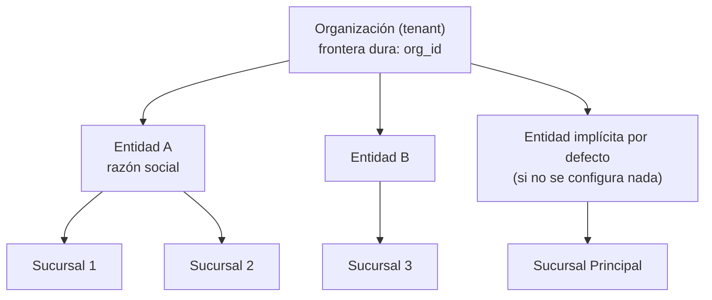
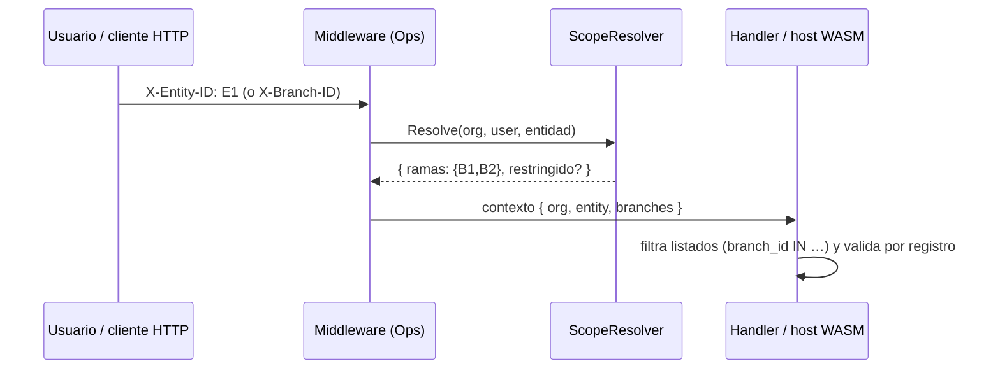
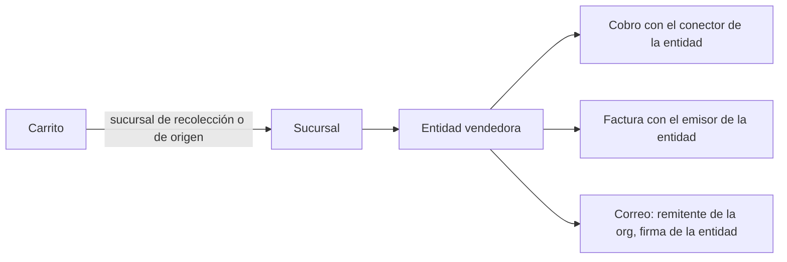
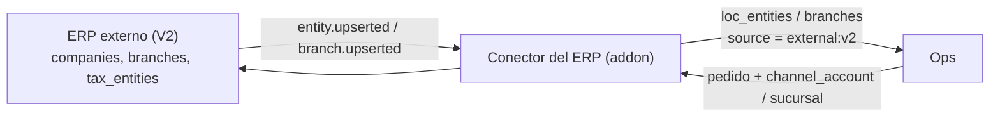

# RFC 0001 — Entidad (razón social) y alcance multi-tenant de la plataforma

- **Estado:** propuesto. Solo diseño: este documento no cambia código.
- **Fecha:** 2026-11-16
- **Repos afectados:** `metacore-kernel`, `metacore-sdk`, `ops`, `addons` (`locations`, `customers`, `inventory`, `storefront_cart`, `channel_orders`, `mercadopago`, `integration_*`), tiendas (`store-*`) y `7leguas-v2` (como ERP externo de referencia).
- **Relacionado:** [ADR 0002](../adr/0002-addon-settings-scoped-store.md) (ajustes con alcance), [RFC de pagos](../RFC-PAYMENTS-STANDARD.md), `7leguas-v2/docs/PLAN-GRUPOS-OPS-ECOMMERCE.md` y `CONTRATO_ECOMMERCE_OPS.md`.

## 0. Resumen

Un grupo empresarial como Grupo Llantero 7Leguas opera varias razones sociales (RFC distinto) bajo una sola marca, un solo ecommerce y un solo equipo. Protek, God's y los clientes futuros pueden tener lo mismo **sin tener un ERP externo**. Hoy la plataforma conoce organización y sucursal, pero no la razón social. Este RFC propone:

| # | Decisión |
|---|---|
| D1 | La **entidad** (razón social / unidad legal) es una primitiva de la plataforma entre la organización y la sucursal. La organización sigue siendo la **frontera de tenant**; la entidad es una frontera de **autorización y fiscal** dentro de ella. |
| D2 | La entidad vive en un **addon** (`locations`), no en el kernel: el kernel no aprende palabras de negocio. El kernel aporta solo el mecanismo genérico de alcance. |
| D3 | Los registros **no duplican** `entity_id`: la entidad se **deriva de la sucursal** (`branch_id` ya existe en el contexto, los eventos y los datos). Los documentos fiscales emitidos guardan una **foto** inmutable de la entidad. |
| D4 | La entidad se **expande a un conjunto de sucursales** y reutiliza el mecanismo de alcance por sucursal que ya existe (`X-Branch-ID`, `branch_members`, comprobaciones por registro). |
| D5 | Ajustes, conectores y proveedores ganan un nivel **entidad** en su cadena de herencia: `sucursal → entidad → organización`. |
| D6 | Un **ERP externo** (V2 para 7Leguas) sincroniza entidades y sucursales por un contrato genérico, con `external_ref` y bandera de fuente de verdad. Ops no inventa datos fiscales que el ERP ya tiene. |
| D7 | Sin configuración, nada cambia: toda organización tiene una **entidad implícita** por defecto. |
| D8 | El rollout es por fases con banderas, y cada fase trae su prueba de aislamiento. |

## 1. Lo que existe hoy (evidencia en el código)

Se revisó el código; lo que no se encontró se declara como tal.

### 1.1 Aislamiento por organización (tenant)
- Las consultas y mutaciones de los addons WASM se acotan por organización: `metacore-kernel/runtime/wasm/dataquery_orgscope.go`, `datamutate_orgscope.go` (con sus pruebas `*_orgscope_test.go`).
- Las credenciales de conectores son por organización: `connectors.Store.Get(ctx, orgID, connectorKey)` (`metacore-kernel/connectors/connectors.go`); en Ops, `org_integrations` con índice único `(organization_id, provider)` (`ops/backend/models/org_integration.go`). **Hallazgo:** hoy no es posible tener dos cuentas del mismo proveedor en una organización (por ejemplo, dos cuentas de Mercado Pago).

### 1.2 Alcance por sucursal (prior art)
- **HTTP:** `ops/backend/middleware/branch_scope.go` lee `X-Branch-ID`; los usuarios con membresías (`branch_members`) quedan restringidos a su conjunto de sucursales y reciben 403 `branch_forbidden` fuera de él; sin membresías o administradores ven todo. `ops/backend/services/branch_scope.go` resuelve, cachea e invalida el conjunto.
- **Por registro:** `ops/backend/handlers/branch_scope.go` cierra las rutas por id (ver, editar, borrar, acciones): un registro fuera del conjunto responde 404, sin filtrar su existencia. Un `branch_id` nulo queda fuera de cualquier conjunto.
- **Listados:** se acotan a la sucursal activa con `f_branch_id`.
- **WASM:** el contexto lleva la sucursal activa (`dynamic.BranchIDFromContext`); los *creates* nacen estampados con ella (`runtime/wasm/datamutate.go`) y los eventos salen con `branch_id` sellado por el host (`capability/event.go`, `HostStampedEventFields`; `dispatch/envelope.go`). **No encontré filtro por sucursal en las lecturas WASM** (`dataquery_orgscope.go` solo acota por organización): la restricción por sucursal vive en la ruta HTTP. El ADR 0002 lo confirma para ajustes («el camino wasm ignora los overrides por sucursal», ya corregido por el resolutor).

### 1.3 Ajustes con alcance (prior art directo)
- ADR 0002: `metacore_addon_settings` con clave `(org_id, addon_key, scope_kind, scope_id)`; hoy `scope_kind ∈ {org, branch}`, precedencia `default del manifest < org < sucursal`, y la interfaz `wasm.SettingsResolver` (`runtime/wasm/settings_resolver.go`) ya recibe sucursal y mercado (`ResolveSettingsInMarket`). Los secretos quedan fuera, en `org_integrations`.

### 1.4 Proveedores por mercado y enrutamiento
- `org_market_providers` `(organization_id, market_code, domain, addon_key, priority, enabled)` (`ops/backend/models/org_market_provider.go`) y el paquete `routing` del kernel: gana la ruta con más prioridad y, después, con más claves de coincidencia (`metacore-kernel/routing/routing.go`). Agregar una clave `entity` a la coincidencia no cambia la regla de precedencia.

### 1.5 Sucursales y tienda
- El addon `locations` modela cada sucursal con dirección, datos fiscales, almacén por defecto, horario y recolección en tienda; la «Sucursal Principal» se crea al instalar (`addons/packages/locations/manifest.json`).
- El SDK ya lleva la sucursal en la entrega: `DeliveryInput { method, rate_id?, branch_id? }` y `PickupOption` (`metacore-sdk/packages/storefront/src/types.ts:438,474`).

### 1.6 Estado real de 7Leguas
- **Ops (148.113.175.214):** 3 sucursales visibles (Servillantas 7 Leguas, San Felipe, Servillantas 7 Leguas Sucursal Bordo), ninguna con entidad.
- **7leguas-v2 (sandbox):** 1 grupo, 1 empresa, 4 sucursales, 2 razones sociales y 0 cuentas de canal; las fases A–D del plan de V2 están en `sandbox`, no en producción (217 commits por delante de `main`).
- **Contrato V2 ↔ Ops** (§0): Ops no decide empresa ni sucursal; manda `channel_account` y V2 resuelve almacén y emisor.

## 2. Problema

1. No existe la **razón social** como concepto de plataforma: no hay forma nativa de separar facturación, cobros, inventario y cuentas de canal por RFC.
2. Los **conectores** son por organización: no se pueden tener cobros de Mercado Pago ni cuentas de Mercado Libre y Amazon por empresa.
3. Un tenant sin ERP (Protek, God's, clientes futuros) no tiene dónde modelar un grupo; un tenant con ERP (7Leguas) tendría dos modelos que podrían divergir.
4. La restricción por sucursal **no llega a las lecturas WASM**: hoy no hay un frontera de entidad exigible fuera de HTTP.

## 3. Diseño

### 3.1 Jerarquía y fronteras



- **Organización:** aislamiento duro entre clientes (no cambia).
- **Entidad:** frontera de autorización y fiscal entre razones sociales del mismo dueño. **No** es una frontera de tenant: comparte base de datos y esquema.
- **Sucursal:** pertenece a **una** entidad (`entity_id` no nulo tras la migración, con la implícita por defecto).

### 3.2 Modelo de datos (addon `locations`)

| Tabla / columna | Contenido |
|---|---|
| `loc_entities` | `id`, `org_id`, `code` (estable, único por org), `legal_name`, `display_name`, `country`, `fiscal` (jsonb), `is_default`, `source` (`ops` \| `external:<sistema>`), `external_ref`, `active` |
| `branches.entity_id` | nullable durante la migración; no nulo después; índice `(org_id, entity_id)` |

- **Datos fiscales genéricos:** `fiscal = { tax_id_type, tax_id, regime, postal_code, … }`. El **tipo** y la validación los aporta el addon de región (`region_mx` define RFC y régimen SAT; otro país aporta NIT, CUIT, RIF…). El núcleo no asume RFC.
- **Identificador estable:** `code` es la clave de mapeo con sistemas externos; los nombres nunca se usan como clave.
- **Fuente de verdad:** si `source = external:<sistema>`, el panel de Ops muestra los datos fiscales en solo lectura. Evita dos orígenes que diverjan.

### 3.3 Derivar la entidad, no duplicarla

Un registro con `branch_id` (ventas, pagos, movimientos de inventario…) tiene la entidad de su sucursal:

```
entity(registro) = branches[registro.branch_id].entity_id
```

- **Registros sin sucursal:** pertenecen a la **entidad por defecto** de la organización (política explícita y documentada por modelo).
- **Documentos fiscales** (factura, nota de crédito, cobro cerrado): guardan una **foto** `entity_id` (y el `code`) en el momento de emitirse. Si una sucursal cambia de entidad después, el historial no se reescribe.
- **Cuándo denormalizar:** solo si la medición lo exige. Regla: si un listado por entidad supera p95 > 300 ms con el tamaño de datos real de 7Leguas (≈ 10⁶ filas en la tabla más grande), se agrega `entity_id` a **esa** tabla, mantenido por trigger y con backfill reversible. No antes.

### 3.4 Alcance como conjunto de sucursales (reutiliza lo que existe)



- Nuevo encabezado **`X-Entity-ID`** (opcional). El resolutor lo expande al conjunto de sucursales de la entidad y lo cruza con `branch_members`.
- Se **extiende, no se reescribe**, `services.BranchScope` y las comprobaciones por registro: el «activo» deja de ser una sola sucursal y puede ser un conjunto. `f_branch_id` admite lista (`IN`).
- **Pertenencia por entidad:** `entity_members` es un atajo que se **resuelve a sucursales** (incluye las futuras de la entidad). No es un segundo sistema de permisos.
- **Frontera exigible en WASM:** el contexto de invocación lleva `{org, entity, branches}` (hoy lleva solo la sucursal activa). Las lecturas WASM que acepten el contexto aplican el filtro por conjunto de sucursales cuando el modelo tiene `branch_id`. Cierra el hallazgo de §1.2.

### 3.5 Cadena de herencia en ajustes, conectores y proveedores

```
sucursal  →  entidad  →  organización  →  default del manifest
```

| Pieza | Cambio | Compatibilidad |
|---|---|---|
| Ajustes (ADR 0002) | `scope_kind` gana `entity`; precedencia `default < org < entidad < sucursal`; claves con `scope: entity` en el manifest | Aditivo; `scope: branch` sigue igual |
| Conectores | `org_integrations` gana `scope_kind` y `scope_id` (nulos = org); índice único `(org, provider, scope_kind, scope_id)`; `connectors.Store.GetScoped(ctx, org, key, scope)` con *fallback* sucursal → entidad → org | `Get(...)` = alcance org; los addons existentes no cambian |
| Proveedores / enrutamiento | `org_market_providers` gana `entity_id` nulo; `entity` pasa a ser clave de coincidencia en `routing` | La regla de precedencia es la existente (más claves = más específico) |

- **Qué se conecta a qué nivel:** Mercado Pago (cobros), Mercado Libre y Amazon → **entidad**; correo, marca → **organización**; impresoras y caja → **sucursal**.
- **Secretos:** siguen fuera de `metacore_addon_settings`; se guardan en `org_integrations` con su alcance.

### 3.6 Permisos

- Roles existentes (propietario, administrador, usuario) sin cambio. Se agrega el **alcance de datos** por entidad y sucursal.
- Sin membresías, el comportamiento actual no cambia (ve todo).
- Auditoría: cada acceso denegado por alcance se registra con la entidad y la sucursal pedidas.

### 3.7 Ecommerce



- **El pedido hereda la entidad de su sucursal** (la de recolección o la de origen del envío).
- **Cobro:** `commerce.payments.session` se enruta por entidad (conector y proveedor por alcance). Un checkout lo cobra **una sola** entidad.
- **Carrito con artículos de varias entidades:** v1 pide separar en dos pedidos (una entidad por checkout) con aviso claro. v2: cobro dividido por vendedor, reutilizando el modelo del RFC de pagos (D10: cobro por vendedor con comisión).
- **Catálogo y precios:** compartidos por la organización; precio por entidad o mercado como capa opcional.
- **Impuestos y moneda:** por mercado (`org_markets`) y por entidad (régimen y país en `fiscal`).
- **Escaparates:** un solo dominio por defecto; un escaparate adicional se modela como un registro de tienda ligado a una entidad y a su dominio (sin tocar el modelo).
- **SDK (`@asteby/storefront`):** `shop` expone las sucursales con su entidad (nombre comercial, sin datos fiscales); el contexto de entrega ya lleva `branch_id`. El SDK **no** recibe `entity_id` ni RFC.

### 3.8 Integración con ERP externo (V2 como referencia)



- **Contrato genérico** (capability `directory.sync` o eventos `entity.upserted` / `branch.upserted`): `code`, `legal_name`, `fiscal`, `branches[]`, `external_ref`.
- **Mapeo por código**, nunca por nombre. Conciliación periódica: diferencias se reportan, no se pisan.
- **En 7Leguas:** `companies` → entidades, `branch.company_id` → `entity_id`. Los pedidos bajan a V2 con la sucursal y la `channel_account`; V2 sigue siendo el emisor de la factura (contrato V2 ↔ Ops §0).
- **Sin ERP:** la entidad se administra en Ops (`source = ops`).

### 3.9 Compatibilidad hacia atrás

- **Entidad implícita:** la migración crea una entidad por defecto por organización y asigna todas las sucursales a ella. Una organización sin entidades configuradas se comporta exactamente como hoy.
- **Capabilities:** el contrato es cerrado. Los campos nuevos son **opcionales** y las versiones se anuncian; ninguna capability existente cambia de forma.
- **Bandera:** `entities.enabled` por organización (apagada por omisión) hasta la fase de rollout.
- **Reversibilidad:** toda migración trae `down`; el backfill es idempotente y solo toca sucursales sin entidad.

## 4. Seguridad y cumplimiento

| Riesgo | Control |
|---|---|
| Una entidad ve datos de otra | Alcance por conjunto de sucursales en HTTP y WASM; 404 (no 403) por registro fuera de alcance; pruebas de aislamiento (§5) |
| Fuga entre organizaciones | Sin cambio: `org_id` sigue siendo la frontera dura; las pruebas existentes `*_orgscope_test.go` se mantienen |
| Credenciales de una entidad usadas por otra | Resolución de conectores por alcance con *fallback* explícito; auditoría de cada `connector_get` con el alcance usado |
| Dinero de una entidad en la cuenta de otra | El conector de pagos es **por entidad**; una entidad sin conector propio no cobra (no hereda el de otra) salvo configuración explícita |
| Reescritura del historial fiscal | Foto `entity_id` inmutable en documentos emitidos |
| Divergencia con el ERP | `source = external:*` ⇒ solo lectura en Ops; conciliación con reporte |
| Cifrado | Sin cambio: secretos con AES-256-GCM en `org_integrations`; `fiscal` no contiene secretos |

## 5. Pruebas de aislamiento (qué fuga cubre cada una)

| Prueba | Fuga que cubre |
|---|---|
| Usuario de la entidad A pide por id un registro de la B → 404 | Lectura cruzada entre entidades (HTTP) |
| Listado con `X-Entity-ID: A` no incluye filas con `branch_id` de B | Filtro de listados |
| Lectura WASM con contexto de A no devuelve filas de B | Frontera en el host WASM (hoy sin cobertura) |
| *Create* con sucursal de B estando en A → 403 | Escritura cruzada |
| `connector_get` desde un contexto de A no devuelve las credenciales de B | Credenciales cruzadas |
| Cobro de un pedido de A usa el proveedor de A, y falla (no hereda) si A no tiene | Dinero cruzado |
| Sucursal cambiada de entidad: el documento fiscal anterior conserva su foto | Historial |
| Organización X no ve nada de la Y con entidades activas | Frontera de tenant intacta |
| Organización sin entidades: mismas respuestas que antes (pruebas golden) | Compatibilidad |

## 6. Plan por fases

| Fase | Alcance | Repos | Riesgo | Tamaño |
|---|---|---|---|---|
| **F0** | Este RFC y las decisiones abiertas | kernel | Bajo | S |
| **F1** | Modelo de entidad y entidad implícita (migración reversible, banderas apagadas) | `addons` (`locations`) | Bajo: aditivo | M |
| **F2** | Alcance por conjunto de sucursales: `X-Entity-ID`, `f_branch_id IN`, contexto WASM `{org, entity, branches}`, selector en el panel | kernel, Ops | Medio: toca el camino de lectura | L |
| **F3** | Cadena de herencia: ajustes `entity`, conectores con alcance, `routing` por entidad | kernel, Ops, addons | Medio | L |
| **F4** | Ecommerce: pedido hereda la entidad, cobro por entidad, foto fiscal, remitente | `storefront_cart`, `channel_orders`, `mercadopago`, SDK | Alto: dinero y facturación | L |
| **F5** | Contrato de ERP y `connector_leguas_v2`; mapeo de empresas de V2 | `addons`, V2 | Medio | M |
| **F6** | Rollout en 7Leguas (entidades reales), después Protek y God's | Ops, tiendas | Alto: datos fiscales reales | M |

**Orden de PRs por repo:** (1) kernel: contexto de alcance y `GetScoped` (aditivos, sin uso); (2) `addons/locations`: entidades; (3) Ops: resolutor y middleware; (4) kernel + Ops: herencia de ajustes y conectores; (5) addons de comercio; (6) SDK y tiendas; (7) V2.

**Métricas de éxito:** 0 fugas en las pruebas de §5; p95 de listados con alcance ≤ 300 ms con los volúmenes de 7Leguas; 0 diferencias en las pruebas *golden* de organizaciones sin entidades; tiempo de alta de una entidad < 5 min; una compra de cada entidad factura con su RFC.

## 7. Alternativas descartadas

- **Una organización por empresa:** duplica catálogo, clientes e inventario, exige logins distintos y no da vista consolidada ni traspasos entre empresas. Se conserva solo para dueños distintos.
- **`entity_id` en todas las tablas:** duplica el dato, obliga a migrar 70+ tablas y se desincroniza al mover sucursales. Se denormaliza solo donde la medición lo exija.
- **Entidad en el kernel:** el kernel debe seguir sin conocer palabras de negocio; entidad es concepto de `locations`/región.
- **Entidad solo en el ERP:** dejaría sin multi-entidad a los tenants sin ERP.

## 8. Decisiones abiertas (requieren al dueño del producto)

1. ¿Una entidad **sin conector de pagos propio** puede usar el del grupo (con liquidación interna) o debe fallar? (Recomendado: falla; opción explícita por entidad.)
2. ¿El carrito con artículos de varias entidades se **separa en dos pedidos** (v1) o se cobra dividido (v2)? (Recomendado: v1.)
3. ¿Precio por entidad desde la F4 o solo catálogo único? (Recomendado: catálogo único, precio por entidad después.)
4. ¿Escaparates por entidad: en el alcance del RFC o diferido? (Recomendado: diferido; el modelo ya lo admite.)
5. Para 7Leguas: datos reales de cada entidad (razón social, RFC, régimen, CP fiscal, serie, PAC) y qué sucursales le pertenecen. **No se cargan ni se inventan** hasta tenerlos.

## 9. Referencias de código

- `metacore-kernel/runtime/wasm/{dataquery_orgscope,datamutate_orgscope,settings_resolver,datamutate}.go`
- `metacore-kernel/{connectors/connectors.go,routing/routing.go,capability/event.go,dispatch/envelope.go}`
- `metacore-kernel/docs/adr/0002-addon-settings-scoped-store.md`
- `ops/backend/{middleware,handlers,services}/branch_scope.go`, `models/{org_integration,org_market_provider}.go`
- `addons/packages/locations/manifest.json`
- `metacore-sdk/packages/storefront/src/types.ts`
