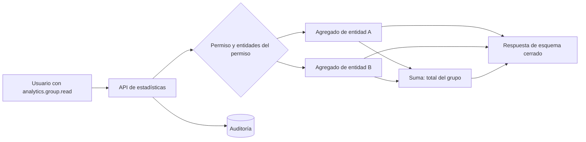

# RFC 0002 — Estadísticas de grupo con aislamiento estricto de documentos

- **Estado:** propuesto. Solo diseño: este documento no cambia código.
- **Fecha:** 2026-11-16
- **Depende de:** [RFC 0001](0001-entidad-y-alcance.md) (entidad y alcance).
- **Repos afectados:** `7leguas-v2` (ERP de referencia), `ops` (motor de tablero), `addons` (widgets de `dashboard` en los manifiestos), `metacore-kernel` (permisos y contrato).

## 0. Resumen

Regla de negocio dada por el dueño del Grupo Llantero 7Leguas:

> Los distintos RFC no deben fusionar datos de ventas ni facturas, pero sí podemos consultar estadísticas a nivel grupo.

La traducimos en un principio técnico con tres niveles de acceso que **no se mezclan**:

| Nivel | Qué ve | Quién | Ejemplo |
|---|---|---|---|
| **N1. Documentos de una entidad** | Ventas, facturas, cobros y movimientos individuales | Usuarios con acceso a esa entidad | Lista de facturas de Servillantas 7 Leguas |
| **N2. Agregados de una entidad** | Sumas, conteos y series de esa entidad | Los mismos | Ventas netas del mes de Servillantas |
| **N3. Agregados del grupo** | Los mismos agregados por entidad y su suma | Solo con el permiso `analytics.group.read` | Ventas netas del mes por RFC y total del grupo |
| **N4. Comparativos entre entidades** | Un RFC frente a otro | Solo con `analytics.group.compare` | Servillantas vs Llantas y Servicios |

Decisiones:

| # | Decisión |
|---|---|
| E1 | Un **agregado** es de solo lectura, se calcula **por entidad** y el total del grupo es la **suma de lo que devolvió cada entidad**. El grupo nunca consulta documentos de varias entidades en una sola pasada. |
| E2 | La respuesta de un agregado es un **esquema cerrado**: no contiene ids de documentos, folios, UUID fiscales, RFC de clientes ni nombres de clientes. Un contrato lo impide y una prueba lo vigila. |
| E3 | El acceso a agregados de grupo es un **permiso propio** (`analytics.group.read`), distinto del acceso a documentos. Tener el permiso **no abre** los documentos de otra entidad. |
| E4 | Toda consulta de grupo queda **auditada**. |
| E5 | Las listas de documentos de un usuario que ve **más de una entidad** no pueden mezclar entidades: exigen entidad elegida (o se parten por entidad). |
| E6 | Una métrica tiene **una sola definición versionada**, común a V2 y a Ops. |
| E7 | Los agregados se **precalculan** por entidad y día para rendir y para conciliar entre sistemas. |

## 1. Evidencia del código actual

Solo se declara lo que se encontró; lo demás se marca como tal.

### 1.1 7leguas-v2 (rama `sandbox`)
- `backend/app/Support/ReportScope.php` es el punto único que resuelve el alcance de un reporte: devuelve `null` (sin restricción) o una lista de ids de sucursal (vacía = nada). Combina `branch_id`, la empresa elegida (`X-Company-Id`) y el acceso del usuario con `BranchAccess::reportingScope`. Tiene `key()` para llaves de caché y `apply*` para acotar consultas.
- `backend/app/Services/BranchAccess.php` opera en dos modos: `log` (por defecto: **no bloquea**, solo registra cada acceso fuera de alcance) y `enforce` (filtra o responde 404). En `log`, `reportingScope` no estrecha por acceso (`$scope = $this->enforcing() ? $allowed : null`).
- `backend/app/Http/Controllers/DashboardController.php` usa `ReportScope::resolve` y define lo que cuenta como venta válida: órdenes sin los estados excluidos `[5, 6, 7, 8, 9, 11, 12]` y pagadas o a crédito (`payment_method = 3`).
- `X-Company-Id` y `CompanyContext` ya existen. La empresa de un registro se deriva de su sucursal.

### 1.2 Ops
- Los tableros son **declarativos**: cada addon declara en su `manifest.json` un arreglo `dashboard[]` de widgets con `permission` y una `query` (`model`, `aggregate`, `field`, `date_field`, `range`) y `compare` (ejemplo: `packages/customers/manifest.json`, widgets `total_customers` y `revenue_month`).
- El alcance por sucursal vive en `ops/backend/middleware/branch_scope.go` (`X-Branch-ID`, `branch_members`, 403 `branch_forbidden`). El RFC 0001 documenta que **las lecturas de los addons WASM no se acotan por sucursal** (solo por organización); la restricción vive en la ruta HTTP.

### 1.3 Hallazgos que condicionan el diseño
1. **En V2 no hay hoy una frontera dura entre RFC.** En modo `log`, y para administradores en cualquier modo, un reporte sin empresa elegida suma **todas** las entidades, y lo mismo vale para las listas de documentos. Los agregados de grupo están bien por regla de negocio, pero **las listas de documentos no deberían poder mezclar RFC**.
2. **No hay desglose por entidad.** El tablero suma todo o muestra una empresa; no entrega «por RFC y total» en una respuesta.
3. **La definición de «venta» está en el código** de un controlador de V2 y no en un contrato: Ops tendrá su propia definición y pueden divergir.
4. **Ops no puede acotar por entidad dentro del WASM** (hallazgo del RFC 0001). Los agregados de grupo deben salir del **motor de tablero del host**, no de lecturas del addon.

## 2. Catálogo de métricas

Una métrica es **segura para el grupo** si es un número agregado que no permite reconstruir un documento ni identificar a un cliente. Cada métrica tiene id, definición y versión (E6).

| Id | Definición (v1) | Grupo (N3) | Comparativo (N4) | Notas |
|---|---|---|---|---|
| `sales_net` | Suma del total sin impuestos de ventas **válidas** menos devoluciones, en el periodo | Sí | Sí | Venta válida = pagada o a crédito, sin cancelaciones, apartados ni solicitudes (misma regla que `DashboardController`, versionada) |
| `sales_gross` | Igual, antes de devoluciones | Sí | Sí | |
| `tickets` | Conteo de ventas válidas | Sí | Sí | |
| `avg_ticket` | `sales_net / tickets` | Sí | Sí | Se **recalcula** desde los agregados, no se promedia |
| `units` | Suma de unidades vendidas | Sí | Sí | |
| `returns` | Monto y conteo de devoluciones | Sí | Sí | |
| `gross_margin` | Venta neta menos costo de lo vendido | Sí, con `analytics.group.margin` | Sí, con el mismo permiso | Sensible: expone costos de forma indirecta |
| `inventory_value` | Existencias valorizadas a costo, a una fecha | Sí, con `analytics.group.margin` | Sí, con el mismo permiso | Es una foto, no un flujo |
| `receivables` | Saldo por cobrar y cobranza del periodo | Sí | Sí | Solo totales; nunca por cliente |
| `top_products` | Ranking de productos del **catálogo compartido** por unidades o venta | Sí | Sí | Producto, no cliente. Mínimo `k` de operaciones |
| `sales_by_channel` | Venta neta por canal (físico, ecommerce, Mercado Libre, Amazon) | Sí | Sí | El canal pertenece a una entidad |
| `sales_by_branch` | Venta neta por sucursal | Sí, **dentro de la entidad**; para otra entidad solo con `compare` | Con `compare` | Una sucursal pertenece a una sola entidad |
| `sales_series` | Serie diaria, semanal o mensual de `sales_net` | Sí | Sí | |

**No son seguras (nunca en agregados de grupo):**
- listas o conteos por **folio, serie o UUID** de factura;
- datos de **clientes**: nombre, RFC, teléfono, saldo o ventas por cliente, historial;
- **movimientos de caja** y cortes individuales;
- cuentas bancarias, tokens y credenciales de cobro;
- **costo por producto** (solo el margen agregado con su permiso);
- cualquier cifra que se obtenga de **menos de `k` operaciones** en un comparativo entre entidades (supresión por tamaño mínimo, valor propuesto `k = 5`), para que un número no revele un documento por inferencia.

## 3. Permisos y auditoría

| Permiso | Qué abre |
|---|---|
| `analytics.entity.read` (existente por entidad) | N2 de las entidades a las que el usuario ya tiene acceso |
| `analytics.group.read` | N3: agregados por entidad y total del grupo. **No** da acceso a documentos |
| `analytics.group.compare` | N4: ver una entidad frente a otra |
| `analytics.group.margin` | `gross_margin` e `inventory_value` en N3 y N4 |

- Un usuario de **una sola entidad** no ve agregados de otras: sin `analytics.group.read` solo recibe su entidad; con el permiso, recibe las que el **permiso** cubre, no las de su acceso a documentos.
- **Auditoría:** cada consulta de grupo escribe quién, cuándo, métricas, rango, entidades incluidas y el resultado (`ok`, `denied`, `suppressed`). Retención sugerida: 13 meses. Un volumen anómalo de consultas dispara una alerta.
- Los permisos son **aditivos y explícitos**; ningún rol existente los trae por defecto, salvo el administrador del grupo.

## 4. Arquitectura: agregar por entidad y sumar



- Cada entidad se consulta **con su propio alcance** (sus sucursales); el total es `Σ entidades`. Nunca existe una consulta que lea documentos de dos entidades a la vez.
- **Moneda:** cada entidad reporta en su moneda. Si hay más de una, el total se entrega **por moneda**; no se suma sin una tasa explícita y versionada.
- **Zona horaria:** los rangos («este mes») se resuelven **por entidad** con su zona; el total del grupo suma los periodos ya resueltos.
- **Conciliación:** `total_grupo = Σ entidades` es un invariante probado. La respuesta lleva `as_of` (corte) y `source` (`v2` u `ops`) para detectar desfases entre sistemas.
- **Precálculo (E7):** tabla `stats_daily(entity_id, day, metric, metric_version, value, currency, source, computed_at)` con refresco incremental y reproceso de los últimos días. Es el origen de las series y de la conciliación entre V2 y Ops.
- **Caché:** la llave incluye permiso, entidades cubiertas, métrica, versión y rango (extender `ReportScope::key`). Una caché compartida sin permiso en la llave sería una fuga.

### 4.1 Contrato (esquema cerrado)

```json
GET /api/group-stats?metrics=sales_net,tickets&from=2026-11-01&to=2026-11-30&group_by=entity

{
  "as_of": "2026-11-16T04:10:00Z",
  "source": "v2",
  "metric_versions": { "sales_net": 1, "tickets": 1 },
  "entities": [
    { "id": "ent_servillantas", "label": "Servillantas 7 Leguas", "currency": "MXN",
      "metrics": { "sales_net": 0, "tickets": 0 }, "suppressed": [] },
    { "id": "ent_llantas_servicios", "label": "Siete Leguas Llantas y Servicios", "currency": "MXN",
      "metrics": { "sales_net": 0, "tickets": 0 }, "suppressed": [] }
  ],
  "group": { "MXN": { "sales_net": 0, "tickets": 0 } }
}
```

Los valores del ejemplo son ceros ilustrativos, no datos reales. El esquema **no admite** campos de documento (`id` de venta, folio, UUID, RFC de cliente, nombre de cliente); un validador de contrato rechaza cualquier campo fuera de la lista.

## 5. Dónde se implementa

### 5.1 7leguas-v2 (vista consolidada de la matriz)
- Servicio `GroupStatsService` y ruta `GET /api/group-stats` con una **policy** `group-analytics` (permiso, no rol). Reutiliza `ReportScope` y `CompanyContext` para el alcance de cada entidad; no duplica la pantalla de empresas.
- **E5 en V2:** en modo `enforce`, las listas de documentos de un usuario que ve más de una empresa exigen `X-Company-Id` (o responden por empresa). Mientras el modo sea `log`, se registran las listas mezcladas como alerta. Pasar a `enforce` es parte del checklist de producción.
- La vista consolidada consume solo esta API, nunca las rutas de documentos.

### 5.2 Ops (tablero de grupo)
- Extender el widget declarativo con tres campos opcionales: `scope: "entity" | "group"`, `group_by: "entity"` y `permission: "analytics.group.read"`. Sin los campos, el widget se comporta como hoy.
- El **motor del host** evalúa el widget por entidad (aplicando el conjunto de sucursales de la entidad, RFC 0001 D4) y suma; los addons WASM **no** leen entre entidades.
- Interfaz: selector de entidad, tarjeta «Total del grupo», etiqueta **«Agregado»** en todo lo que sea N3 y **«Documento»** en listas, y un candado visible cuando una métrica requiere permiso. Los comparativos solo aparecen con `analytics.group.compare`.

### 5.3 Consistencia entre V2 y Ops
- V2 es la fuente fiscal. Ops muestra lo que recibe del ERP más lo que nace en la tienda y en los canales. Para 7Leguas, Ops **no recalcula ventas fiscales**: muestra los agregados que V2 entrega por la API y los del ecommerce por separado, rotulados por `source`. Un job de conciliación compara `stats_daily` de ambos y alerta diferencias.
- La definición de cada métrica vive en este catálogo versionado y se prueba contra datos de muestra en ambos sistemas.

## 6. Pruebas de no fuga

| # | Prueba | Fuga que cubre |
|---|---|---|
| T1 | Un usuario de la entidad A pide `group-stats` sin permiso → 403 | Agregados de grupo sin permiso |
| T2 | Un usuario con `analytics.group.read` pide **documentos** de la entidad B → 404 | El permiso de grupo no abre documentos |
| T3 | `total_grupo = Σ entidades` para todas las métricas y para rangos que cruzan zona horaria | Suma incorrecta o doble conteo |
| T4 | Un comparativo con menos de `k` operaciones se suprime y se declara en `suppressed` | Inferencia de un documento |
| T5 | En `enforce`, una lista de documentos con más de una entidad visible sin entidad elegida se rechaza | Mezcla de documentos |
| T6 | Validador de contrato: la respuesta no contiene folio, UUID, RFC de cliente, nombre de cliente ni ids de documento | Fuga por campos extra |
| T7 | Dos usuarios con permisos distintos no comparten caché | Fuga por caché |
| T8 | Cada consulta de grupo deja un registro de auditoría | Consultas sin rastro |
| T9 | Entidades con monedas distintas no se suman | Total sin sentido |
| T10 | Los agregados de V2 y de Ops coinciden con los datos de muestra | Definiciones divergentes |

## 7. Fases

| Fase | Entrega | Repos |
|---|---|---|
| E1 | Este RFC: catálogo, permisos, contrato | `metacore-kernel` |
| E2 | `GroupStatsService`, API, permiso, auditoría y pruebas T1–T10 (en `sandbox`) | `7leguas-v2` |
| E3 | Extensión del widget y tablero de grupo | `ops`, `addons` |
| E4 | `stats_daily` y precálculo | `7leguas-v2`, `ops` |
| E5 | Conciliación entre V2 y Ops y alertas | `ops`, `7leguas-v2` |

Orden: E1 → E2 (puede ir en paralelo con la pantalla de empresas de V2) → E4 → E3 → E5. Nada llega a producción de V2 sin el checklist de promoción del plan de grupos.

## 8. Riesgos y mitigaciones

| Riesgo | Mitigación |
|---|---|
| Un reporte sin empresa elegida mezcla RFC | E5, modo `enforce` antes de producción, prueba T5 |
| Un agregado revela un documento (poca muestra) | Supresión por `k` y prueba T4 |
| Dos definiciones de «venta» divergen | Catálogo versionado y T10 |
| Caché compartida entre permisos | Llave con permiso y alcance, prueba T7 |
| Agregados de grupo como puerta trasera a documentos | Esquema cerrado, validador de contrato (T6) y T2 |
| Márgenes y costos filtrados | Permiso aparte `analytics.group.margin` |
| Rendimiento de agregar sobre tablas grandes | `stats_daily` precalculada y medición antes de denormalizar |

## 9. Decisiones abiertas

1. **Valor de `k`** para la supresión en comparativos (propuesto 5).
2. ¿`gross_margin` visible para el administrador del grupo por defecto, o solo con asignación explícita? Recomendado: explícita.
3. ¿Los comparativos entre entidades están apagados por defecto? Recomendado: sí.
4. ¿Qué monedas y tasas se admiten en el total del grupo si una entidad opera en otra moneda?
5. Retención de la auditoría (propuesto 13 meses).
