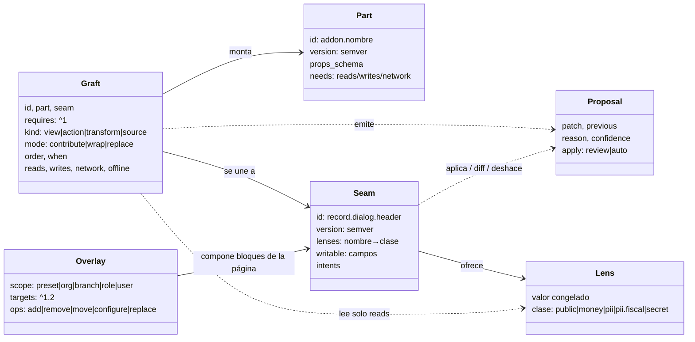
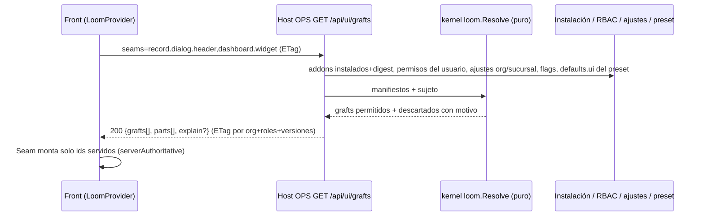
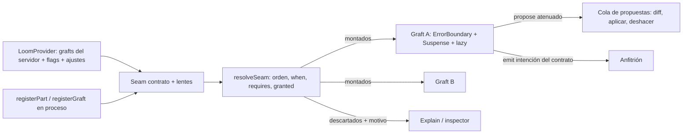
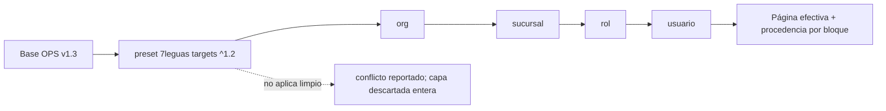

# RFC 0005 — Loom: contribuciones de UI (Seams, Grafts, Lenses, Proposals, Overlays)

- **Estado:** propuesto (borrador para revisión). No se mergea hasta revisarlo.
- **Fecha:** 2026-11-20
- **Repos:** `metacore-kernel` (manifiesto v3, resolvedor), `metacore-sdk` (`runtime-react/src/loom`), `ops` (endpoint y montaje), addons (`fiscal_mexico`, `pos`, `vehicles`), presets (7 Leguas).
- **Relacionado:** `docs/spec/v3/slots.md` (catálogo `ops.host/v1`), RFC 0003 (eventos), `RFC-PRESETS-DE-EMPRESA-Y-DISTRIBUCION.md`, 7leguas `docs/migracion-go/08-7leguas-como-preset-ops.md` §10 y `09-loom-extension-de-ui.md`.
- **Prototipo:** SDK `feat/ui-contributions` (`packages/runtime-react/src/loom`).

## 0. Resumen

Un addon tiene que poder **exponer** componentes con contrato y **injertarlos** en pantallas de otros (el lector de constancia fiscal en el modal de cliente, el resumen de venta en el POS, 23 widgets en el tablero) sin forkear el front, sin ver más datos de los necesarios y sin que un fallo tumbe la pantalla. Un preset (7 Leguas) tiene que poder **componer** páginas (quitar, mover, reconfigurar bloques) sin código.

Ya existen casi todas las piezas, pero dispersas en seis registros con reglas distintas. Loom no añade un séptimo: **les da un modelo común** y lo que les falta (contrato versionado, lentes con clase de datos, propuestas revisables, autorización en servidor, overlays y explicabilidad).

| # | Decisión |
|---|---|
| D1 | Cinco conceptos: **Part** (componente expuesto), **Seam** (punto de extensión con contrato), **Graft** (injerto Part→Seam), **Lens** (vista de solo lectura del contexto con clase de datos), **Proposal** (cambio propuesto, nunca mutación directa). Más **Overlay** para componer páginas. |
| D2 | **Extender, no reinventar.** `contributions.slots[]`, `slotStore`, `<AddonSlot>`, `registerRecordPrefill` y `registerFieldWidget` siguen funcionando sin cambios y se proyectan como Grafts. |
| D3 | **Todo componente dinámico nace extensible**: `DynamicRecordDialog`, tabla, formulario y tablero publican seams automáticos; el anfitrión solo declara a mano los especiales (`pos.cart.summary`). |
| D4 | **El servidor decide qué se monta.** Un resolvedor puro del kernel filtra por instalación, RBAC, ajustes, flags y preset; el host lo sirve en `GET /api/ui/grafts`. El cliente no monta lo que el servidor no listó (filtra otra vez solo para UX y para explicar). |
| D5 | **Capacidades, no estado.** El injerto recibe solo las lentes que declaró (`reads`) y funciones atenuadas: `propose` deja pasar solo `writes ∩ writable`; `emit` solo intenciones del contrato. |
| D6 | **Proponer, no mutar.** Constancia fiscal, sugerencia de precio, lector de código y Aby usan el mismo flujo: diff «antes → después», aplicar/descartar, deshacer. Auto-aplicar solo si el preset lo permite. |
| D7 | **Privacidad por construcción.** Cada lente tiene clase (`public`, `internal`, `money`, `pii`, `pii.fiscal`, `secret`); el runtime redacta errores y telemetría de injertos que leen clases sensibles, aunque el autor se equivoque. |
| D8 | **Contratos con semver.** El injerto declara `requires: "^1"`; si no cumple no se monta, nada rompe y el motivo se ve en Explain. |
| D9 | **Tres niveles de confianza**: código del host; addon privado de la organización confiado por **digest exacto** (SRI obligatoria, ya vigente); marketplace aislado en iframe con API por mensajes. |
| D10 | **Overlays deterministas** sobre el grafo de bloques: base OPS < preset < org < sucursal < rol < usuario; cada capa es atómica y declara contra qué versión de la base se escribió; si no aplica limpio cae a la base y avisa. |
| D11 | **Escalera de intrusión**: `contribute` (por omisión) < `wrap` < `replace`; `replace` exige aprobación en el preset, fallback al original y telemetría. |
| D12 | **Explain** en todo: cada injerto y bloque sabe de dónde viene (addon, versión, digest, capa) y por qué algo NO se ve (condición, permiso, versión, overlay). |

## 1. Lo que existe y qué hace Loom con ello

| Pieza existente | Dónde | Qué hace Loom |
|---|---|---|
| `contributions.slots[]` (`slot_kind`, `entry`, `order`, `permission`, `props`, `timeout_ms`, `fallback`, `condition`) | kernel `manifest/v3/types.go` `SlotContribution` | **Se reutiliza.** El resolvedor la proyecta como Graft `view` con `part = <addon>.<entry>`. Ningún manifiesto cambia. |
| `extension_points.slot_kinds[]` (`name`, `props_schema`) | kernel `PublishedSlot` | **Se generaliza** a `ui.seams[]` (contrato con versión, lentes, writable, intenciones). `slot_kinds` se lee como seam `0.x` sin lentes. |
| Catálogo `ops.host/v1` (7 kinds) | `HostSlotCatalogOpsV1` | **Se conserva** como contratos `1.0.0` del host; se añaden los seams automáticos del SDK (§10). |
| `<AddonSlot>` (federado, boundary, Suspense, timeout, `addon_slot_failed`) | SDK `slots/addon-slot.tsx` | **Se reutiliza** su carga (`loadFederatedModule`, SRI, timeout, rango `frontend.sdk`). En fase 2 `<AddonSlot kind>` pasa a ser `<Seam>` con contrato heredado. |
| `slotStore` / `<Slot>` | SDK `sdk/src/slot-store.ts` | **Se reutiliza** como registro en proceso; sus entradas se leen como Grafts sin lentes. |
| `registerRecordPrefill` / `RecordPrefillBar` (ya con `allowedKeys`) | SDK | **Se generaliza**: es exactamente el seam `record.dialog.header`; `applyValues` pasa a ser `propose`. Adaptador en fase 2, retirada con aviso de deprecación. |
| `registerFieldWidget` + `setValues` | SDK | **Se conserva** para widgets de valor de campo (`field.widget`); `setValues` se atenúa con `writes` en fase 2. |
| `registerModelExtension` (`headerExtras`, `toolbarExtras`) | SDK | Se reexpresa como seams `table.header` / `table.toolbar`. |
| `contributions.dashboard[]` (`stat…block|custom`) | kernel + OPS | Los `custom` son Grafts en `dashboard.widget`; la rejilla es un grafo de bloques sobre el que operan overlays. |
| `Condition` (`addon_installed`, `connector_connected`, `unmet`) | kernel | **Se reutiliza** tal cual dentro de `when`. |

**Hallazgo.** El kernel no filtra `contributions.slots[]` (no tiene código de host) y en OPS no encontramos el filtro por `permission`/`condition` de slots en `backend/` (`/metacore/manifests` sirve el manifiesto); el comentario de `host-slots.tsx` asume que «ya vienen filtrados». Hoy la autorización de un slot es, en la práctica, del cliente. D4 lo corrige.

## 2. Modelo conceptual



- **Part.** Lo que un addon **expone**: un componente con id `<addon>.<nombre>`, versión, esquema de props y lo que necesita. No sabe dónde se monta. `fiscal_mexico.csf-import` es un Part.
- **Seam.** Un lugar con **contrato** en un anfitrión. El contrato fija qué lentes ofrece (y su clase), qué campos acepta en propuestas y qué intenciones atiende. Lo publica quien es dueño de la pantalla (el SDK para sus componentes dinámicos, OPS para su shell, el addon `pos` para el POS).
- **Graft.** La unión Part→Seam: orden, condiciones, lentes que lee, campos que puede proponer, red que usa. Se llama *graft* y no *contribution* porque `contributions.*` ya nombra todo lo que aporta un manifiesto (modelos, acciones, menú); así el término no choca.
- **Clases de graft.** `view` (pinta), `action` (comando: botón, atajo, acción de fila), `transform` (función pura sobre valores antes de guardar: normalizar RFC, exigir vehículo), `source` (proveedor de datos: opciones, búsqueda). `transform` y `source` también **proponen**; un `transform` puede además **bloquear** con un motivo (exigir vehículo al cobrar un servicio).
- **Lens.** Proyección **copiada y congelada** del contexto. El injerto que no declaró `values` no recibe `values`. La clase de datos viaja con la lente.
- **Proposal.** `{patch, reason, confidence, labels, apply}`. El seam la atenúa (`writes ∩ writable`), la muestra como diff con el valor anterior y guarda el «antes» para deshacer. Nada se guarda en el servidor hasta que el usuario pulsa Guardar del anfitrión.

## 3. Dos escaleras

**Declarativo → componente → código.** La mayoría de personalizaciones son datos: campos, columnas, widgets del tablero sobre bloques `genui`, overlays. Si hace falta comportamiento, un Part registrado; solo si necesita su propio bundle, ESM federado. Cada peldaño cuesta más revisión y más superficie de ataque.

**Intrusión.** `contribute` añade al seam (por omisión, sin aprobación). `wrap` decora un componente entero del anfitrión (recibe `children`, p. ej. envolver el diálogo de cobro con un aviso): requiere declararlo en el preset. `replace` sustituye: requiere `approved_by_preset`, el original queda como **fallback** automático y cada fallo cuenta para la autocuración (§9).

## 4. Manifiesto v3 (aditivo)

Bloque nuevo `ui`, opcional. Un manifiesto sin `ui` se sirve **idéntico** (prueba de ida y vuelta en fase 2).

```jsonc
{
  "key": "fiscal_mexico",
  "ui": {
    // Componentes expuestos (Parts)
    "exposes": [
      {
        "id": "fiscal_mexico.csf-import",
        "version": "1.0.0",
        "expose": "./parts/csf-import",          // expose del remoto federado (frontend.container)
        "props_schema": "schemas/csf-import.props.json",
        "needs": { "network": "none", "offline": true }
      }
    ],
    // Seams que este addon publica para otros (generaliza extension_points.slot_kinds)
    "seams": [],
    // Injertos (Grafts)
    "contributions": [
      {
        "id": "fiscal_mexico.csf-in-customer",
        "part": "fiscal_mexico.csf-import",
        "seam": "record.dialog.header",
        "requires": "^1",
        "kind": "view",
        "order": 10,
        "when": {
          "model": ["Customer", "Supplier"],
          "mode": ["create", "edit"],
          "permission": ["customer.create"],
          "setting": { "key": "fiscal_mexico.csf_reader", "equals": true },
          "condition": { "addon_installed": "customers" }
        },
        "reads": ["values", "mode", "recordId"],
        "writes": ["name", "tax_id", "postal_code", "fiscal_data.*"],
        "emits": ["record.select", "record.edit"],
        "network": "none",                     // none | org | hosts (+ "hosts": [...])
        "offline": true
      }
    ]
  }
}
```

Un seam publicado por un addon (el POS):

```jsonc
"ui": { "seams": [{
  "id": "pos.cart.summary", "version": "1.0.0",
  "lenses": { "cart": "money", "customer": "pii", "branch": "internal" },
  "writable": [], "intents": ["pos.cart.add_line", "pos.checkout.block"],
  "cardinality": "many"
}]}
```

**Reglas de validación** (warnings la primera minor, igual que `slot_kind_unknown`): id de Part/Graft calificado `<addon>.<nombre>` y único; `part` existe en este manifiesto o se declara dependencia del addon dueño; `seam` en el catálogo del host, del SDK o publicado; `requires` es un rango semver válido; `writes` no incluye columnas gestionadas (`id`, `organization_id`, `created_*`, `updated_*`, `deleted_at`) — **error duro** desde el principio; `network` es `none|org|[hosts]` y cada host aparece en la CSP del addon; `mode: replace` solo desde un preset.

**Compatibilidad.** `contributions.slots[i]` se proyecta como `{id: "<addon>.slot.<i>", part: "<addon>.<entry>", seam: slot_kind, requires: "0 - 1", kind: "view", order, when: {permission, condition}, reads: ["*legacy*"]}`: la lente heredada `context` llega entera (como hoy) y se marca `legacy` en Explain. Nada cambia para quien no migra.

**Presets.** Un preset no trae código (`presetconfig` lo rechaza y se mantiene). Trae `defaults.ui`: qué grafts activa o desactiva por id, su `order`, `auto_apply` de propuestas por graft y los `overlays[]` (§7).

## 5. Resolución en el servidor



- **Kernel**: paquete puro `ui/loom` con `Resolve(manifests []Manifest, subject Subject, preset PresetUI) Result`. Sin base de datos ni HTTP (mismo patrón que `runtime/setfields`). `Subject` = org, sucursal, permisos, ajustes efectivos, flags. `Result` = grafts permitidos con su Part (`expose`, `container`, `integrity`, `version`) y, si el usuario tiene `ui.explain`, los descartados con motivo.
- **Host**: monta el endpoint, cachea por `(org, hash de roles, versión de instalaciones, versión del preset)` y lo invalida con los eventos que ya existen (instalar, cambiar rol, cambiar ajuste).
- **El servidor es la fuente de verdad**: el cliente vuelve a evaluar `when` solo para responder en caliente (modo del formulario, modelo) y para explicar; **nunca** amplía lo servido. Toda escritura sigue pasando por la API con su RBAC: un injerto que logre proponer un campo no autorizado se topa con el mismo 403/422 de siempre.

## 6. Carga en el cliente



- `<Seam contract lenses host onProposal onIntent>` resuelve (función pura `resolveSeam`), monta cada injerto en su `FederatedErrorBoundary` + `Suspense`, con carga perezosa (`React.lazy` sobre `load()` o `loadFederatedModule` con SRI y timeout, reutilizado de `AddonSlot`). Un injerto que falla desaparece en silencio y reporta `graft_failed` (redactado según clases).
- Los injertos no se esperan entre sí ni bloquean el primer render del anfitrión.
- Sin `LoomProvider`, solo monta lo registrado en proceso (código del host).

## 7. Overlays: componer páginas sin fork

Una página es un **grafo de bloques** ordenado (`{id, type, region, config}`); el tablero ya lo es. Un overlay es una capa de operaciones:

| Operación | Efecto |
|---|---|
| `add {block, before|after}` | inserta; id repetido o ancla inexistente = conflicto |
| `remove {id}` | quita (Explain: «lo quitó la capa X») |
| `move {id, before|after, region}` | reordena o cambia de región |
| `configure {id, set}` | fusión profunda de `config`; arrays se sustituyen; `null` borra |
| `replace {id, with}` | sustituye conservando el id; el original queda como `fallback` |



Semántica: orden fijo por alcance (empate = orden de entrada); **cada capa es atómica** (si una operación falla, la capa entera no aplica; la página nunca queda a medias); `targets` es el rango de versión de la base contra el que se escribió: si la base sube de mayor y el overlay ya no cumple, **cae a la base y avisa** en el panel de admin. La función es pura y determinista (`applyOverlays`, con pruebas en el prototipo). Validación al publicar: esquema + aplicar la capa contra la base actual en CI del preset; un overlay que no aplica limpio no se publica.

## 8. Versionado de contratos

Cada seam tiene semver. **Menor**: añadir lentes, intenciones o campos escribibles. **Mayor**: quitar o cambiar el significado de una lente. El anfitrión puede servir dos mayores a la vez durante una ventana de deprecación (`deprecated: {since, removal}`); el validador avisa a los addons que piden la mayor vieja. Un injerto que no cumple `requires` no se monta (motivo `version`). Los Parts versionan sus props igual.

## 9. Seguridad y confianza

| Nivel | Qué es | Cómo corre | Qué ve |
|---|---|---|---|
| Host | código del SDK/OPS | en proceso | todo lo que el anfitrión decida |
| Privado de la organización | addon asignado a la org (7 Leguas) | ESM federado en el mismo realm; **digest exacto** (SRI obligatoria, ya vigente en OPS) | solo sus lentes; capacidades atenuadas |
| Marketplace | addon público de terceros | **iframe sandbox** (`allow-scripts`, sin `allow-same-origin`), API por `postMessage` con las mismas capacidades | solo lentes serializadas; sin DOM ni cookies del host |

Matriz de amenazas (qué puede hacer un injerto malicioso y cómo se contiene):

| Amenaza | Contención |
|---|---|
| Leer datos que no necesita | solo recibe `reads`; el servidor no lo sirve si su `reads` pide clases no permitidas al usuario |
| Escribir campos ocultos (`organization_id`) | `propose` atenuado (`writes ∩ writable`); `writes` sobre columnas gestionadas es error de validación; la API valida igual |
| Exfiltrar por red | `network: none` → sin hosts en la CSP del addon; marketplace en iframe sin red salvo `network` declarada; en el nivel privado la red es **declarativa + revisada + CSP** (el mismo realm no permite bloquear `fetch` de forma fiable: se dice tal cual) |
| Filtrar PII por logs/errores | redacción por clase en `graft_failed` y telemetría; el boundary nunca envía stack ni mensaje de un injerto que lee `pii*` |
| Romper la pantalla | boundary + Suspense + timeout por injerto; fallback silencioso; autocuración |
| Suplantar UI del host (phishing de PIN) | marketplace no puede `wrap`/`replace`; los seams sensibles (aprobaciones, cobro) son `contribute` solo para privados |
| Cambiar de código sin revisión | el digest se fija al instalar; un bundle distinto no carga (`RemoteIntegrityError`) |
| Saturar | presupuesto por seam (tamaño de chunk, tiempo de montaje) medido y reportado |

**Caso constancia fiscal.** El Part lee el PDF o el QR **en el navegador** (`pdfjs` y el lector de QR del SDK); el archivo no se sube, no se guarda y no se loguea; `network: none` (validar el QR contra el SAT, si se quiere, es otra contribución explícita con `network: ["siat.sat.gob.mx"]` y aviso al usuario). Lo leído entra como **propuesta**: el usuario ve RFC, nombre, régimen y CP antes/después y decide. Sus errores salen como `[redactado: pii]`.

## 10. Catálogo inicial de seams

| Seam | Dueño | Lentes (clase) | Acepta | Prioridad |
|---|---|---|---|---|
| `record.dialog.header` | SDK `DynamicRecordDialog` | `model`, `mode` (public), `recordId` (internal), `values` (pii), `fields` (public) | propuestas sobre campos editables; `record.select`, `record.edit` | **P0 (prototipo)** |
| `record.form.section` | SDK `DynamicRecordDialog` | igual | igual; contenido dentro del modal | **P0 (prototipo)** |
| `record.field.<key>.before/after` | SDK | igual + `field` | propuestas | P1 |
| `table.toolbar`, `table.row.actions`, `table.empty`, `table.header` | SDK `DynamicTable` | `model`, `filters` (internal), `selection` (internal), `row` (pii) | `action`; `table.refresh` | P1 |
| `dashboard.widget` | OPS tablero | `range`, `branch` (internal) | bloques del grafo; overlays | P1 (montar `custom` dentro de la rejilla) |
| `document.form.summary` | SDK `DocumentFormDialog` | `document` (money), `lines` (money), `customer` (pii) | `transform` (bloquear/advertir) | P1 |
| `pos.cart.summary`, `pos.checkout.footer`, `pos.customer.after` | addon `pos` | `cart` (money), `customer` (pii), `branch` | `pos.checkout.block`, `pos.cart.add_line` | P2 |
| `field.widget` | SDK (registro existente) | `value`, `record` (pii) | `onChange`; `setValues` atenuado | P1 |
| `display.layout` | OPS `/display` | `state` publicado (internal) | **solo bloques `genui`** vía overlay | P2 |
| `record.panel`, `record.action`, `list.toolbar`, `page.header`, `topbar.item`, `settings.section` | OPS `ops.host/v1` | contexto heredado | contrato `1.0.0` | ya existen |

**Pantalla de cliente (`/display`).** Es un shell estático del binario, abierto con un token de solo lectura en un dispositivo no confiable: **no debe cargar ESM de addons**. El seam `display.layout` acepta solo bloques declarativos `genui` sobre un grafo de bloques del shell, servidos por el servidor junto con el estado. Un preset reordena y reconfigura con overlays; un addon aporta bloques (no código). Si un día hace falta código, va en el nivel marketplace (iframe) aunque el addon sea privado.

**Vehículo exigido por servicios.** `vehicles.picker` (Part `field.widget`) + `workshop.require-vehicle` (Graft `transform` en `document.form.summary` que bloquea el cobro con motivo si hay servicio sin vehículo). La regla real vive en el servidor (validación de la venta); el transform solo adelanta el aviso.

## 11. Transversales

- **i18n:** los Parts traen su bundle (`i18n.bundles`); las cadenas del runtime usan `loom.*` con valores por omisión en español; las etiquetas de lentes salen del formulario del anfitrión.
- **Tema:** los injertos usan solo tokens del tema (`bg-muted`, `text-muted-foreground`, glass del shell) y primitivos de `@asteby/metacore-ui`; prohibido CSS global (el validador del bundle lo detecta: selectores sin ámbito).
- **Accesibilidad:** el diff es una `region` con nombre, tabla con encabezados, botones con texto; la barra de deshacer es `role=status`; foco: ningún injerto roba el foco al abrir.
- **Rendimiento:** cada Part es un chunk perezoso; presupuesto inicial 50 KB gz por Part de seam de formulario; el seam no espera a sus injertos; `GET /api/ui/grafts` con ETag y una petición por pantalla.
- **Observabilidad:** `graft_failed{seam,graft,addon,reason}` y `proposal_dropped_keys` por el canal de incidentes existente (`reportFrontendIncident`), redactados; tasa de fallos por graft y versión.
- **Canario y autocuración:** el preset fija `rollout` por org/sucursal/rol/porcentaje; si la tasa de `graft_failed` de una versión supera el umbral, el servidor deja de servirla (vuelve a la anterior o a la base) y lo muestra en Explain.
- **Sin conexión:** `offline: true` → el POS (PWA) precachea el Part por digest; los `offline: false` se ocultan sin red con motivo `offline`.

## 12. Pruebas y DX

- **Contrato por seam:** cada seam exporta su contrato y un arnés (`renderSeam(contract, lenses)`) que verifica: monta, no lanza con lentes vacías, solo propone `writes`, respeta `requires`. Un Graft no se publica si no pasa los contratos de los seams a los que se une.
- **Harness para autores:** `@asteby/metacore-runtime-react/testing` sumará `mountGraft()` con lentes de ejemplo por seam (playground).
- **Tipos generados:** `ui.seams[]` → `SeamLenses<'record.dialog.header'>` para que `GraftProps` esté tipado por seam.
- **Scaffolding:** `create-addon --part csf-import --seam record.dialog.header`.
- **Inspector en desarrollo:** `<LoomProvider inspect>` pinta en cada seam qué injertos lo llenan y por qué los demás no (ya en el prototipo, mínimo).

## 13. Prior art: qué tomamos y qué no

| Referencia | Tomamos | Descartamos |
|---|---|---|
| VS Code *contribution points* | declaración en el manifiesto, activación por condición (`when`), catálogo de puntos | la extensión con acceso amplio al API en el mismo proceso |
| Backstage *extension points* | puntos tipados publicados por su dueño | DI de backend como mecanismo de UI |
| Module Federation | carga ESM (ya la usamos, con SRI) | compartir estado global entre remotos |
| Shopify UI extensions | **targets con contrato**, API reducida, sandbox para terceros | componentes propietarios remotos (usamos los primitivos propios) |
| WordPress hooks | filtros como `transform` | mutación libre de cualquier dato por cualquier plugin |
| kustomize | overlays por capas con parches declarativos | parches por posición de array (usamos ids estables) |

Lo propio: **lentes con clase de datos y redacción automática**, **propuestas revisables con deshacer** como único canal de escritura, **capas de overlay atómicas con versión de base** y **Explain** de lo que no se ve.

## 14. Fases (por valor/riesgo)

| Fase | Entrega | Repos | Riesgo |
|---|---|---|---|
| 1 | SDK: `loom` (Seam, Graft, Part, Lens, Proposal, Overlay puro, inspector), seams `record.dialog.header` y `record.form.section` en `DynamicRecordDialog`, intenciones en `CustomerPicker` | SDK | bajo, aditivo (**prototipo**) |
| 2 | Kernel: `ui.exposes/seams/contributions` + validación + proyección de `contributions.slots[]` + `ui/loom.Resolve` puro. OPS: `GET /api/ui/grafts` y `LoomProvider` en el shell; `fiscal_mexico.csf-import` como Part | kernel, OPS, addons | medio |
| 3 | SDK: seams de tabla, formulario y tablero; adaptadores de `RecordPrefill`, `slotStore` y `AddonSlot`; `setValues` atenuado. OPS: `custom` dentro de la rejilla | SDK, OPS | medio |
| 4 | Overlays del preset sobre tablero y POS; `display.layout` declarativo; seams del addon `pos` | OPS, addons, presets | medio |
| 5 | Operación: canario, autocuración, Explain en admin, precacheo offline, sandbox de marketplace | OPS, SDK | alto |
| 6 | DX: tipos generados, playground, pruebas de contrato generadas, scaffolding | SDK | bajo |

## 15. Estado y lo aprendido al implementar (2026-11-20)

| Pieza | Dónde | Estado |
|---|---|---|
| `loom` del SDK: Seam, Graft, Part, Lens, Proposal, `applyOverlays`, inspector; seams `record.dialog.header` y `record.form.section`; intenciones en `CustomerPicker` | SDK #1557 | publicado en `@asteby/metacore-runtime-react@53.29.0` |
| Bloque `ui` (Go + esquema en sus 2 copias + validación) y paquete puro `loom.Resolve` | kernel #675 | mergeado |
| Lector de constancia como Part `fiscal_mexico.csf-import` + injerto en el modal estándar; borrados `PosCustomerPicker` y `CustomerRecordDialog` | 7leguas `feat/loom-csf-graft` (local) | verificado con Playwright y PDF sintético: rellena, deshace, el PDF no sale del navegador y no hay escrituras |
| `GET /api/ui/grafts` y `LoomProvider` en el shell de OPS | OPS | pendiente: OPS está en kernel v0.295 y `loom` llega en una versión posterior |

Ajustes al diseño que salieron de implementar:

1. **El tipo Go es `UIBlock`** (no `UI`): `manifest/v3/ui.go` ya nombra «superficies de UI» (páginas, vistas, paneles). El campo del manifiesto sigue siendo `ui`.
2. **`network` es texto + `hosts`** (`none|org|hosts`), no una unión texto/array: esquema más simple y validable.
3. **`apply: "auto"` existe y hace falta.** El lector de constancia ya tiene su propio paso de revisión campo a campo; pedir un segundo diff habría cambiado el flujo que conoce el personal. Regla adoptada en §16.2.
4. **Dos intenciones estándar del formulario**: `record.select` (el RFC ya existe: usar ese cliente) y `record.edit` (abrir su edición con el parche como propuesta). Las atiende quien abrió el diálogo (`useRecordPickerDialog`); sin anfitrión que las atienda, el injerto cae a proponer el parche.
5. **Las lentes se copian antes de congelarlas**: congelar en sitio rompía el estado del formulario del anfitrión.
6. **El servidor no evaluaba `contributions.slots[].permission`/`condition`**: `loom.Resolve` los aplica al proyectar los slots heredados como injertos `legacy`.
7. Un injerto registrado en proceso sigue siendo necesario mientras el host no sirve `/api/ui/grafts` (el POS de 7 Leguas declara el suyo con `registerGraft`); con `LoomProvider serverAuthoritative` solo se montan los ids servidos.

## 16. Decisiones tomadas (2026-11-20)

1. **Loom** y su vocabulario (Part, Seam, Graft, Lens, Proposal, Overlay) son API pública.
2. **Regla de .** Una propuesta solo se aplica directa (, siempre con «Deshacer») si la Part declara su propio paso de revisión (; en el SDK ) **y** ningún campo del parche es de clase  (;  marca  y ). En cualquier otro caso el seam la baja a diff revisable, también para el parche que viaja en . El preset no puede saltarse la regla. Implementado y probado: SDK , kernel  (#685).
3. **Marketplace** corre en iframe sandbox y **nunca** puede  ni .
4. **** solo declarativo (bloques  + overlays), sin ESM.
5. ****: en desuso desde la versión que publica la regla de  (aviso una vez por sesión); dos versiones menores con el aviso y después queda como **adaptador permanente** que proyecta cada prefill como Graft en  ( → ). Nadie tiene que migrar a la fuerza.
